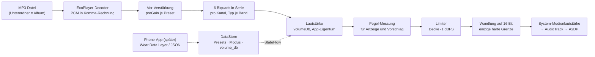
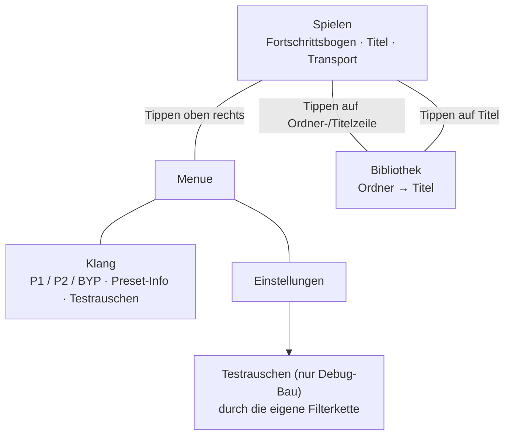

# NotchedMusic – Umsetzungsplan: Modi, 6-Band-EQ, Bibliothek, Player-Oberfläche

> **Status: Historischer Entwurf, weitgehend umgesetzt.** Dieses Dokument beschreibt den
> ursprünglichen Watch-Entwurf (zwei Presets, vier Filtertypen, fünf Seiten). Der aktuelle Stand
> (13.11.2026) ist **drei Presets, sieben Filtertypen, echter Phone-Sync**; die Abweichungen und
> der verifizierte Stand stehen in Abschnitt 12 sowie in `PROJEKTSTATUS.md`. Abschnitt 11 ist
> weiterhin die Liste der geklärten beziehungsweise offenen Fragen.

Ausgangslage (ist fertig und gemessen): Wear-OS-Modul, `MediaSessionService` mit ExoPlayer,
Hintergrundwiedergabe überlebt Bildschirm-AUS (auf dem Emulator verifiziert), dunkles OLED-Schema
(5,3 % helle Pixel, Vorgabe ≤ 15 %), Notch-Filterkette mit 4,6 ns/Sample (3 Bänder, 48 kHz, Stereo).

Neu gewünscht: 2 gespeicherte EQ-Presets + Bypass als dritte Wahl, bis zu 6 frei parametrierbare
Filter pro Preset (Lowshelf/Highshelf/Peak/Notch, Frequenz auf Hz genau, Q, Gain), Einstell-Screen,
rekursive Bibliothek mit Ordnern (Alben), ausführliche Player-Oberfläche, Lautstärke, alles ohne
Buffer-Underruns und ohne hörbares Nachklingen.

---

## 1. Klangweg – wie es später aussieht



**Warum intern nichts übersteuern kann:** zwischen Decoder und Limiter wird mit Komma-Zahlen
gerechnet. Komma-Zahlen kennen keinen begrenzten Bereich – ein Zwischenwert von +40 dB ist eine
völlig normale Zahl, kein Fehler. Übersteuerung ist physikalisch erst dort möglich, wo aus der
Komma-Zahl eine **Ganzzahl** (16 Bit) werden muss. Deshalb sitzt die gesamte Pegel-Technik *vor*
dieser einen Stelle:

| Stufe | Gehört | Aufgabe |
|---|---|---|
| Vor-Verstärkung `preGainDb` | **Preset** (Phone-App) | gleicht Presets untereinander ab; gleicht die Notch-Absenkung aus |
| **Lautstärke `volumeDb`** | **Uhr** (DataStore) | der Hörer-Regler der App: dreht alles gemeinsam herunter, bevor die Wandlung kommt – die Krone bedient ihn |
| Pegel-Messung + Limiter | Uhr, automatisch | misst den Ausschlag, fängt Rest-Spitzen ab, meldet dauerhaftes Limitieren |
| Wandlung auf 16 Bit | Uhr | die einzige harte Grenze im digitalen Teil |

Dahinter wirkt noch die **System-Medienlautstärke der Uhr** – nach der Wandlung, also außerhalb
unserer Kette. Sie kann Übersteuerung nicht mehr reparieren, nur leiser machen. Empfehlung als
einmaliger Hinweis in den Einstellungen: System-Lautstärke hoch lassen (~80 %) und **über unsere
App-Lautstärke regeln** – die wirkt vor der Wandlung und ist damit der saubere Weg.

> [!IMPORTANT]
> **Drei Pegel, drei Zuständigkeiten – deshalb braucht das Preset keinen vierten.**
>
> | Pegel | Wirkt | Merkt sich | Zuständig für |
> |---|---|---|---|
> | `preGainDb` (im Preset) | in der Kette, vor dem EQ | Preset / Phone-App | Presets angleichen (Klang-Design) |
> | `volumeDb` (auf der Uhr) | in der Kette, nach dem EQ, **vor** der Wandlung | unser DataStore | Übersteuerung verhindern + Hörpegel; Krone und Bluetooth greifen hierauf zu |
> | System-Medienlautstärke | nach unserer Kette | das System, pro Bluetooth-Gerät | Grobabstufung fürs Ohr |
>
> Der Grund für `volumeDb` in der App statt nur der System-Lautstärke: Gegen die Wandlung auf
> 16 Bit hilft kein Regler danach mehr – ist ein Wert einmal abgeschnitten, ist die Verzerrung
> schon da. Die eigene Stufe ist außerdem unabhängig von System und Kopfhörer, überlebt deren
> Wechsel und kann später von der Phone-App **mit** den Preset-Werten geschickt werden, ohne die
> System-Lautstärke des Nutzers anzufassen.
>
> **Und weil es „einfach sein" muss: der Limiter arbeitet vollautomatisch.** Er verhindert
> Abschneiden ohne einen Handgriff. Die Lautstärke ist nur dann von Hand zu senken, wenn der
> Limiter dauernd arbeitet (dann klingt es auf Dauer gepresst). Dafür zeigt die Oberfläche live
> den Ausschlag und bietet bei dauerhaftem Limitieren per **einem Tipp** „−2 dB" an. Kein Menü,
> kein Regler-Wandern, keine Kalibrier-Seite.

## 2. Digitaler Filter – die bewusste Technikentscheidung

**Grundbaustein bleibt das Biquad (2. Ordnung, Transposed Direct Form II).** Für alle vier geforderten
Filtertypen gibt es exakte RBJ-Formeln; jeder Filter kostet pro Sample 5 Multiplikationen und
4 Additionen – **egal welcher Typ**. Sechs Bänder × 2 Kanäle = 12 Biquads ≈ **9 ns/Sample** bei
48 kHz (Hochrechnung aus der gemessenen 3-Band-Kette), das sind **0,09 % einer CPU-Kernzeit**.

Zur Sorge „Algorithmus zu einfach": der richtige Schritt nach oben ist **nicht** eine
FFT-/Faltungslösung („linear-phase EQ"). Die hätte bei einem schmalen Notch eine Impulsantwort von
mehreren Hundert Millisekunden, braucht Puffer von 4–8 kB pro Kanal und erhöht die CPU-Last um
Größenordnungen – genau das Gegenteil von dem, was eine Uhr braucht. IIR erster Wahl ist hier der
Standard, weil er bei gleicher Wirkung ~0 Latenz und minimale Last hat.

Was stattdessen die Qualität wirklich hebt (und was jetzt fehlt):

| Punkt | Heute | Geplant |
|---|---|---|
| Koeffizienten | bei Preset-Wechsel sofort getauscht → **Knacken möglich** | Weiche Überblendung über 128 Samples (Koeffizienten-Interpolation), kein Klick beim Regeln am Handy |
| Zustand/Rechengenauigkeit | `Float`-Zustand, `Double`-Koeffizienten | bleibt so (für Q ≤ 30 nachweislich gut); **Test** prüft auf DC-Drift und anwachsende Impulsantwort |
| Runden der Sample-Werte | Abschneiden | **entchieden: Runden** – praktisch kostenlos, siehe unten |
| Übersteuerung | harter Clamp | **entchieden: Limiter**, Decke **−1 dBFS**, 1 ms Attack / 50 ms Release |
| Allokation im Audiopfad | Wechsel-Arbeitspuffer wird je Aufruf erzeugt | ein fester Arbeitspuffer (max. Puffergröße), kein Objekt-Neubau im Takt |
| Bänder | Notch-artig über Bandbreite | 4 Typen + `enabled` je Band, `Q` direkt, Shelf-Flanke optional |

### Was Runden und Limiter kosten

**Runden ist gratis, nicht fast gratis.** Der Übergang von Komma-Zahl (Filter) zu Ganzzahl
(Audio-Ausgabe) ist auf der Hardware immer genau ein Umwandlungsbefehl; der Unterschied ist nur
dessen Rundungs-Modus – Abschneiden Richtung Null (heute) gegen nächsten Wert (geplant, in Kotlin
`Float.roundToInt()`). Die Laufzeit setzt beide in denselben Befehl um. Die Obergrenze fangen wir
*vor* der Umwandlung im Komma-Bereich ab (`coerceIn(-1f, 1f)`), dadurch bleibt der Pfad ohne
Sonderzweige. Der Benchmark misst die Umwandlung mit, damit das keine Behauptung bleibt. Bewusst
**ohne** Dithering: das wäre echte Zusatzrechnung plus ein hörbar leises Rauschen – bei
verlustbehaftetem MP3-Material ohne Gewinn.

**Limiter: zwei Multiplikationen, zwei Additionen, ein Vergleich pro Sample** – grob so viel wie
*ein halbes* Biquad, bei 6 Bändern unter 4 % Zusatz auf die Kette. Attack und Release kosten nichts
extra, sie sind nur die Glättungs-Konstante. Abschneiden ist bei Bändern mit bis zu +24 dB kein
Randfall mehr, sondern ein Zustand, den ein Preset mit zwei, drei überlappenden Anhebern regelmäßig
trifft – und ein Zerrsignal enthält Energie über das ganze Band, also genau auch in dem Bereich,
den der Notch ruhigstellen soll. Deshalb zwei Schichten: das **Validieren** begrenzt die
Summen-Anhebung aller Bänder zusammen (max. +12 dB, läuft einmal beim Ändern eines Presets, nie
pro Sample), der Limiter mit Decke **-1 dBFS** bleibt das Fangnetz, nicht die Regel.

### Hörbares Nachklingen – ehrliche Einordnung

> [!IMPORTANT]
> Ein schmaler Notch **muss** zeitlich verschmieren – das ist Zeit-Frequenz-Unschärfe, kein
> Implementierungsfehler. Die Hüllkurve klingt mit `Q/(π·f₀)` ab. Bei Q = 100 und 8 kHz ergibt das
> rund 27 ms Nachklang; bei Q = 8 sind es ~2 ms und unhörbar. Deshalb:
> * **Q-Obergrenze 30** (heute 100) – breiter Notch, immer noch sehr selektiv, aber ohne Schmieren
> * Voreinstellung Q = 4…8 für Tinnitus-Notche
> * ein Test misst die Abklingzeit der Impulsantwort und vergleicht sie mit der Theorie – so sieht
>   man Limit-Zyklen oder anwachsende Ausgaben sofort, statt sie zu hoffen

> [!NOTE]
> **Latenz ist bewusst kein Ziel.** Das Gerät ist ein Musikplayer, kein Telefon – die Kette hat
> keinen Rückkopplungspfad, auf den Verzug lästig wirken könnte. Deshalb: keine Vorausschau im
> Limiter, keine Linearphasen-Filter, keine bewusste Puffer-Verkleinerung. Alle
> Entscheidungen unten fallen zugunsten von **Rechenaufwand, Speicher und Akku**, nie zugunsten
> von Latenz.

### Filter-Datenformat (zugleich das Bluetooth-Protokoll)

```json
{
  "version": 2,
  "preGainDb": -6.0,
  "bands": [
    { "type": "NOTCH",     "frequencyHz": 7300.0, "q": 8.0,  "gainDb": -24.0, "enabled": true },
    { "type": "LOW_SHELF", "frequencyHz":   90.0, "q": 0.71, "gainDb":   -3.0, "enabled": true }
  ]
}
```

* `type`: `LOW_SHELF | HIGH_SHELF | PEAKING | NOTCH` (Reserve: `LOW_PASS`, `HIGH_PASS`)
* `frequencyHz` als `Double`, Anzeige ganzzahlig in Hz (Telefon kann exakt eingegeben, Uhr dreht grob)
* `q` direkt (Anzeige-Hilfe: „entspricht 912 Hz Bandbreite"), Bereich 0,1 … 30
* `gainDb` Bereich **±24 dB** je Band (Anforderung ±20 plus Luft), Vor-Verstärkung ±12 dB
* **`volumeDb` (Hörer-Lautstärke) ist bewusst nicht im Preset** – sie gehört auf die Uhr
  (Abschnitt 1): Die Phone-App soll den Klang schicken, aber nie über den Hals des Nutzers
  hinweg dessen Lautstärke verstellen
* `enabled` je Band: Telefon kann ein Band stummschalten, ohne es zu löschen
* **max. 6 Bänder** – das Validieren schneidet Überzählige ab, der Audiopfad wirft nie

`bypass` wandert aus dem Preset heraus in den **Modus** (siehe 3) – ein Preset beschreibt nur noch
den Klang, nicht die Schaltstellung. Das ist für die Phone-App klarer.

## 3. Modi und Speicherung

```kotlin
enum class FilterMode { PRESET_1, PRESET_2, BYPASS }
```

**Wirksam ist immer genau ein Preset** – P1 und P2 werden nicht gestapelt. `BYPASS` → Kette ohne
Bänder (Lautstärke und Limiter bleiben aktiv – der Hörpegel ändert sich beim Umschalten nie).

Weil später mehr als zwei Presets möglich sind, werden sie **nicht** als zwei Felder abgelegt,
sondern als **geordnete Sammlung mit Kennung** (`PresetStore: Map<PresetId, FilterPreset>` plus
Reihenfolge). Ein drittes Preset ist dann nur ein neuer Eintrag – Modus-Aufzählung, Datenbank-
Schlüssel und die Phone-Schnittstelle bleiben dafür unverändert.

* **DataStore Preferences** (Abhängigkeit ist schon im Projekt), Schlüssel: Presets als JSON,
  `modus`, `volume_db`, `display_wach_behalten`, `zuletzt_synchronisiert`
* **`volume_db` ist unser Hörpegel** (Abschnitt 1): eine Stufe für alles, unabhängig von System und
  Kopfhörer, überlebt Gerätewechsel. Die System-Medienlautstärke speichern wir **nicht** mit – die
  ist beim System in besten Händen (sie merkt sich ihre Stufe pro Bluetooth-Gerät)
* Eine Quelle der Wahrheit: `AudioState(preset, mode, flags)` als `StateFlow`; `FilterSettings` wird
  von einem `object` mit Handarbeit zu einer Repository-gekapselten Stelle
* Der Audiopfad liest weiterhin nur ein `@Volatile` Feld – DataStore-IO passiert nie im Audio-Thread
* Erster Start: P1 = bewährter Standard (Notch 8 kHz), P2 = leer, Modus = P1

## 4. Bibliothek: Wurzelordner mit Alben

Der Musikordner ist der **private App-Ordner der Uhr** – Wear OS hat keine
Berechtigungsdialoge, deshalb ist das der einzige Weg ohne System-Medienmediathek:

```
/sdcard/Android/data/de.notchedmusic.watch/files/Music/     ← Wurzel
├── 2024-03 Notch 7,3 kHz/                                   ← Album (Unterordner)
│   ├── 01 - Morgen.mp3
│   └── 02 - Abend.mp3
└── Einzelspur.mp3                                           → im Sammel-Ordner „Wurzel“ mit dabei

// Tiefere Unterordner innerhalb eines Ordners (z. B. Zusatz/Regen.mp3) erzeugen kein
// eigenes Album – ihre Dateien zählen zum umgebenden Album.
```

Auf der Uhr einspielen (der Emulator und jede verbundene Uhr, USB oder WLAN-Debugging):

```
adb push "C:\Musik\2024-03 Notch 7,3 kHz" "/sdcard/Android/data/de.notchedmusic.watch/files/Music/"
```

Danach in der App auf **Neu laden**. In Android Studio geht dasselbe grafisch über das Fenster
**Device Explorer**. Die TicWatch ist kein USB-Massenspeicher und MTP gibt es auf Wear OS nicht –
später kann die Phone-App Dateien über die Data Layer Strecke schicken (Grenzgröße beachten).

Scannen:
* **Ein Ordner direkt unter der Wurzel = ein Album**, fertig. Kein Album-Baum, keine zweite
  Ebene in der Oberfläche
* Innerhalb eines Albums wird **rekursiv flachgezählt**: Unterordner darunter erzeugen keine
  eigenen Alben, ihre Dateien gehören zum Album dazu (Reihenfolge: Nummerierung, sonst Name)
* Dateinamen wie `01 - Morgen.mp3` → Titel „Morgen“, Sortierindex 1; sonst alphabetisch
* Dateien lose in der Wurzel laufen nicht ins Leere: sie sammeln sich im Ordner „Wurzel“
* Verstecktes (`.filename`) ignorieren; Schutz gegen Fehlerbäume: max. 6 Ebenen, max. 2 000
  Dateien, max. 200 Alben. Scannen auf `Dispatchers.Default`, genau **ein** Durchlauf pro
  „Neu laden“ – beim Wechsel in den Hintergrund wird nie gescannt
* **keine** `MediaMetadataRetriever`-Schleife (pro Datei eine teure Öfnung, nur für eine Zahl in
  einer Liste, die niemand liest). Die Laufzeit des laufenden Stücks kommt kostenlos aus dem
  Spieler – die steht deshalb nur auf der Spielseite

## 5. Oberfläche – fünf Seiten, ein Ring, eine Krone

Leitplanken: 466 × 466 rund, OLED (≤ 15 % helle Pixel – messbar, siehe 8), Wischen vom linken
Rand = zurück, eine Hand, kurze Blicke.

**Die TicWatch 5 Pro hat genau eine Krone: sie ist gerastert drehbar und zusätzlich drückbar.**
Daraus folgt die Bedienhierarchie – und sie ist besser als jede Touch-Geste:

| Eingabe | Auf Listen (Bibliothek, Klang, Einstellungen) | Auf der Spielseite |
|---|---|---|
| **Krone drehen** | wie gewohnt durch die Liste scrollen (Systemverhalten, wir ändern es nicht) | **Lautstärke** (1 Raster = 1 Stufe) |
| **Krone drücken** | Systemverhalten behalten (zurück) | unverändert lassen – nicht umbelegen |
| Touch | tippen, ziehen, halten | wie rechts |

Eine Regel für alles: **die Krone bedient den Hauptregler der jeweiligen Seite** – auf Listen das
Scrollen (unverändertes Systemverhalten, so bedient sich jede Wear-App), auf der Spielseite die
Lautstärke. Dort gibt es ohnehin nichts zu scrollen, also gibt es keinen Konflikt.

> [!NOTE]
> **Es gibt kein Vorsuchen innerhalb eines Stücks.** Sprünge sind ausschließlich Stück zurück/weiter
> und Ordner zurück/weiter. Das erspart uns Such-Slider, Positions-Setzen, einen Umschalt-Modus für
> den Ring – und damit einen Haufen Zustand und Rechenarbeit. Der Fortschrittsbogen wird zur reinen
> Anzeige.



### Seite „Spielen" (Startseite)

```
        ⌚ 10:24            ← TimeText (System, ambient-fähig)
   [ P1 ▾ ]              ☰     ← Modus-Knopf · Menü
      ╭─────────╮
    ╱  ●━━━━○      ╲      ← Bogen = reiner Fortschrittszeiger (nicht bedienbar)
   │  Morgen        │         Mitte: Titel (2 Zeilen)
    ╲ 3 · 12 / 7 · 3 ╱       darunter „Titel 3 von 12 · Ordner 3 von 7“
      ╰─────────╯          ← Kron-Drehen hier = Lautstärke
     ⏮      ⏯      ⏭       ← Leiste am unteren Bogen
```

Bedienung (bewusst kurz, weil die Uhr kein Menü verzeiht):

| Geste | Wirkung |
|---|---|
| **Krone drehen** | **Lautstärke**, 1 Raster = 1 Stufe; kurze Einblendung `────●── 12` |
| Bogen am Schirm **ziehen** | dasselbe, für die Hand ohne Krone |
| **⏯** | Play/Pause |
| **⏮ / ⏭** | Titel zurück / weiter (am Ordnerende weiter in den nächsten Ordner) |
| **⏮ / ⏭ halten** | **ganzer Ordner** zurück / weiter – Einblendung „Ordner 3 von 7 · 12 Titel" |
| **Modus-Knopf** tippen | P1 → P2 → BYP durchschalten |
| **Modus-Knopf halten** | Bypass **nur solange gedrückt** – der A/B-Vergleich, um schnell reinzuhören |
| Titel-/Ordnerzeile tippen | zur Bibliothek |
| Wischen vom Rand | zurück (Menü/Bibliothek) |

> [!NOTE]
> Der Bogen ist **Anzeige, kein Regler**: er zeigt, wo im Stück wir sind, und hat keine
> Berührungsfläche. Absicht – ein Regler, der wie eine Anzeige aussieht, ist die häufigste
> Fehlerquelle auf 466 Pixeln. Bedient wird über Knöpfe und Krone, und beide sind eindeutig.

> [!TIP]
> Kronen-Lautstärke ist auf dem **Emulator** sofort prüfbar: Simulator-Knöpfe und Mausrad liefern
dieselben Dreh-Ereignisse. Die Einblendung zeigt die Stufe – so sieht man die Wirkung auch ohne
> Ton, solange die Kopfhörer noch fehlen.

### Seite „Bibliothek"

Zwei Stufen, keine Baumstruktur:

1. **Ordner-Liste** – Kopf „7 Ordner · 84 Titel", pro Reihe Ordnername plus darunter klein
   „12 Titel"; der aktuelle Ordner hat eine Akzent-Kontur. Krone scrollt, Tippen öffnet.
2. **Titel-Liste** des Ordners – Index + Titel, das laufende Stück hervorgehoben (und
   einautomatic-scroll zu ihm, wenn die Seite geöffnet wird). Tippen spielt ab und kehrt zu
   „Spielen" zurück.

Warum Liste *und* Knöpfe: die Knöpfe auf der Spielseite sind der schnelle eine Handgriff („nächster
Ordner"), die Liste beantwortet die andere Frage – **welche Ordner gibt es überhaupt und wo bin
ich gerade**. Beides zusammen ist billiger als ein Menü, das man sich merken muss.

### Seite „Klang"

* Drei-Segment-Umschalter **P1 · P2 · BYP** (selbst gezeichnet, dunkle Füllung, Akzent-Rahmen
  um das aktive Segment)
* Pro Preset eine Karte: „P1 · 4 Bänder · tiefstes: Notch 7 300 Hz" plus „Bearbeiten per Smartphone"
* **Testrauschen** – nur im Debug-Bau sichtbar (Abschnitt 7b): weisses Rauschen, durch die eigene
  Filterkette geschickt. Damit hörst du jedes Band als „Loch“ im Rauschen, ohne Phone-App und ohne
  Musikdatei
* Knopf ist ein Halte-Knopf: solange gedrückt, solange rauscht es – kein eigener Zustand, keine
  Gefahr, dass es anbleibt

### Seite „Einstellungen"

| Eintrag | Was dahintersteht |
|---|---|
| Bluetooth / Smartphone | Status („verbunden · letzte Übernahme 14:02"), „Übernahme jetzt", Ablehnungsgrund bei fehlerhaftem JSON |
| Display | **Schalter: „Display wach halten beim Hören"** (`keepScreenOn`); „Abgedunkelt anzeigen" (eigene Ambient-Darstellung) |
| Audio | **Lautstärke `volumeDb`** (unser Regler, derselbe wie auf der Spielseite), Pegel-/Limiter-
  Anzeige mit Ein-Tipp-Vorschlag „−2 dB", Vor-Verstärkung des aktiven Presets; unten ein Hinweis auf
  die System-Medienlautstärke der Uhr (mit Sprung dorthin) |
| Bibliothek | Pfad (kopierbar zum Abtippen per adb), Titel-/Ordnerzahl, „Neu laden" |
| Info | Version, letzte Filter-Benchmark, „Auf Werkeinstellungen zurück" |

> [!WARNING]
> **Die App kann den Bildschirm-Timeout des Systems nicht setzen** – das ist eine
> Systemeinstellung (Einstellungen → Anzeige). Was wir steuern können: `keepScreenOn` für unsere
> Screens und eine eigene, stark abgedunkelte Ambient-Darstellung. Der Plan verspricht deshalb nur
> die beiden Punkte, die technisch gehen, und verlinkt in den Einstellungen auf den Systemwert.

### Weitere UI-Regeln

* Ein `AppScaffold` (in der Activity), pro Screen ein `ScreenScaffold`
* Navigation 3 mit `rememberSwipeDismissableSceneStrategy()` (Wischen = zurück, Standardgefühl)
* Keine Flächenfarben: Füllungen nachtdunkel, Auszeichnung über helle Schrift und 1-dp-Konturen
* Alle Werte mit Einblend-Hinweis beim ersten Mal (z. B. „Halten für Ordner"), danach nie wieder
* Dreh-API: auf Listen das eingebaute Scrollen der `TransformingLazyColumn` (verhält sich mit der
  Krone von allein richtig); auf der Spielseite ein eigener `ScrollableState`, der die Drehung auf
  Lautstärke-Stufen abbildet – dort gibt es nichts zu scrollen, also keinen Konflikt
* Keine Such-Funktion weit und breit: kein `seekTo`, kein Positions-Ziel, kein Umschalt-Modus.

## 6. Was auf dem Gerät noch zu prüfen ist

| Thema | Prüfen | Wenn nein |
|---|---|---|
| Kronen-Stufe passt? | 1 Raster = 1 Lautstärke-Stufe, Verhalten auf der echten Uhr | Stufen pro Raster an einer Stelle nachstellen |
| Kronendruck = System-Zurück? | Verhalten auf der Uhr prüfen | unverändert lassen, nicht umbelegen |
| A2DP-Codec mit der Amiron 3000 | Entwickleroptionen → Bluetooth-Audio-Codec | – (Koeffizienten werden je Sample-Rate neu berechnet, also egal) |
| 6 Bänder unter Last | 30 min Wiedergabe, `dumpsys cpuinfo`, Hörtest auf Aussetzer | Bänder intern in Blöcke rechnen; Q weiter begrenzen |
| Speicher der App | `dumpsys meminfo` nach 30 min: Heap darf nicht wachsen (Leck-Schutz) | Allokationsstellen im Audio-Pfad suchen |
| Akku | 60 min Wiedergabe mit/ohne „wach halten", `dumpsys batterystats` | Ambient-Darstellung härtender machen |

## 7. Dateien im Überblick

**dsp/** (reine Mathematik, keine Android-Typen)
* `EffectBand.kt` **[neu]** – Filtertyp-Aufzählung, Band, Grenzen, Validierung, `maxBands = 6`
* `FilterPreset.kt` **[ändern]** – Format version 2 wie oben, ohne `bypass`
* `Biquad.kt` **[ändern]** – 4 Typen, Koeffizienten paarweise (alt → neu) für Überblendung
* `EffectChain.kt` **[neu, ersetzt `NotchFilterChain.kt`]** – Biquads pro Kanal, Überblend-Fenster,
  Vor-Verstärkung, Limiter, fester Arbeitspuffer
* `Limiter.kt` **[neu]** – keine Lautstärke-Stufe: die übernimmt die Uhr (Abschnitt 1)
* `Pcm.kt` **[ändern]** – Runden, keine Zwischen-Arrays
* `EffectAudioProcessor.kt` / `EffectAudioProcessorChain.kt` **[umbenannt, geändert]** –
  `@Volatile preset`, `@Volatile volumeDb`, Arbeitspuffer, Neu-Konfiguration bei Sample-Raten-Wechsel

**playback/**
* `FilterMode.kt` **[neu]**, `SettingsRepository.kt` **[neu, DataStore]**,
  `FilterSettings.kt` **[ändern]**, `PlaybackService.kt` **[ändern]** (Klangzustand → Prozessor,
  Abmelden wenn nichts spielt), `PlaybackController.kt` **[ändern]** (`volumeDb` setzen/lesen über
  den Klangzustand – **nicht** über `AudioManager`; Titel/Ordner überspringen anhand der
  Album-Grenzen; **kein** `seekTo`)

**data/**
* `MusicLibrary.kt` **[ändern]** – rekursiv, `Album(name, path, tracks)`, Nummerierung, Obergrenzen

**ui/**
* `Navigation.kt`, `NavKeys.kt` **[neu]**
* `screen/PlayerScreen.kt`, `screen/LibraryScreen.kt`, `screen/SoundScreen.kt`,
  `screen/SettingsScreen.kt`, `screen/MenuScreen.kt` **[neu]**; `MainScreen.kt` **[entfällt]**
* `components/ProgressArc.kt` (reine Anzeige, nicht bedienbar), `VolumeOverlay.kt` (Kurzanzeige der
  `volumeDb`-Stufe beim Kronendrehen), `LevelMeter.kt` (Pegelanzeige + Ein-Tipp „−2 dB" bei
  Dauer-Limitieren), `ModeSwitch.kt`, `TransportRow.kt`, `InfoChip.kt`, `HintHud.kt` **[neu]**
* `debug/NoiseSource.kt` **[neu, Debug-Quelle]** – weisses Rauschen als `MediaSource`, läuft durch
  denselben Pfad wie Musik (Decoder → EQ → Limiter) statt an der Kette vorbei
* `theme/Theme.kt` **[ändern]** – OLED-Kontur-Farben, Formen; Screenshots als Regression

**Tests** (JVM, laufen auf dem PC)
* `BiquadResponseTest` – alle 4 Typen: Plateau-Gewinn, Mittenfrequenz auf 1 Hz genau, Q ↔ Breite
* `BandStackingTest` – 6 Bänder derselben Frequenz addieren sich wie erwartet; `enabled` schaltet
  einzeln; Reihenfolge-Austausch ändert die Summenwirkung nicht (Unabhängigkeit)
* `CoefficientSmoothingTest` – Preset-Wechsel mitten im Signal erzeugt keinen Abtast-Sprung > Schwelle
* `RingingTest` – Impulsantwort klingt mit `Q/(π·f₀)` ab, wächst nie, kein `NaN`/`Inf`
* `LimiterTest` – keine Übersteuerung bei 6 × +24 dB, Angriff/Erholung ohne Klickgeräusch
* `EffectChainBenchmark` **[ersetzt DspBenchmarkTest]** – 6 Bänder gemischt, stereo, 48 kHz:
  Mittelwert **< 15 ns/Sample** *und* schlechtester Einzel-Puffer < 1 ms (fängt Neu-Berechnungs-Spitzen ab)
* `AlbumScanTest` – ein Ordner = ein Album, tiefere Unterordner zählen zum Album, lose Dateien im
  Wurzel-Ordner, Nummerierung, versteckte Dateien, Obergrenzen
* `AudioStatePersistenceTest` – Modus/Preset/Lautstärke überleben „Neustart" (Rundlauf durchs JSON)
* `OledPixelBudgetTest` **[Geräte-Test]** – jeder Screen: helle Pixel im runden Schirm ≤ 15 %
* `NoiseSpectrumTest` – Rauschen durch die Kette: mit aktivem Notch messbar weniger Energie im
  Band als ohne (der Hörtest hat damit auch einen Zahlenbeweis)

## 7b. Debug-only-Werkzeuge – historischer Entwurf, inzwischen gestrichen

> Dieser Abschnitt beschreibt den früheren Plan. Das Testrauschen samt `diagnose/`-Quellen und
> `NoiseWavTest` wurde entfernt; die App enthält keine Debug-Rauschwerkzeuge mehr.

Der Wunsch „nur, solange wir testen“ braucht eine technische Grenze, die nicht beim Menschen liegt.
Deshalb drei Schichten, von billig bis wasserdicht:

| Schicht | Umsetzung | Wirkung |
|---|---|---|
| 1. Quelle | Code in `app/src/debug/kotlin/…` statt `main/` | existiert im Release-Bau **nicht** – der Compiler kennt die Klassen schlicht nicht |
| 2. Zugriff | Interface (z. B. `DiagnoseWerkzeuge`) in `main/`, Implementation nur in `debug/`; App-Start reicht je nach Bauvariante die echte oder eine Leer-Implementierung durch | UI-Code bleibt in beiden Bauen übersetzbar, Release bekommt die leere Variante |
| 3. Anzeige | `BuildConfig.DEBUG` steuert den Knopf auf der Seite „Klang“ | im Release-Bau ist der Eintrag unsichtbar |

Dafür nötig: `buildConfig = true` im `buildFeatures`-Block. Bei AGP 9 ist diese Funktion
**standardmäßig aus** und steht bei uns aktuell auf `false`; erst mit `true` entsteht die Klasse
`BuildConfig` mit ihrem Feld `DEBUG` (AGP-9-Doku bestätigt genau diesen Weg). Eigene Felder würden
über das neue `BuildConfigField`-API eingetragen – brauchen wir hier nicht.

**Was in diese Schicht gehört:** das Testrauschen – und künftig alles andere, was nur dem
Nachmessen dient (Pegel-Kurvenausgabe, erzwungener Sample-Raten-Wechsel zum Prüfen der
Neu-Berechnung, Preset-Ablehnungs-Protokoll). Der reguläre Weg bleibt davon unberührt.

> [!IMPORTANT]
> **Das Rauschen läuft durch dieselbe Kette wie die Musik** – als eigene `MediaSource` im
> Dienst, nicht als separater Tonpfad. Würde man es an der Filterkette vorbei direkt auf die
> Audio-Ausgabe legen, wäre der Hörtest wertlos: man hörte dann das Rauschen unverändert.

> [!TIP]
> Rauschen statt Sinus-Kehre ist für Notche die bessere Wahl: weisses Rauschen enthält alle
> Frequenzen gleichzeitig, jedes aktive Band zeigt sich als „Loch“ – und bei sechs Bändern sieht
> und hört man alle auf einmal, statt sie nacheinander abzufahren.

## 8. Reihenfolge der Umsetzung

| # | Schritt | Ergebnis / Beweis |
|---|---|---|
| **A** | DSP-Ausbau: 4 Filtertypen, Q, Gain, `enabled`, 6 Bänder, Überblendung, Limiter, Runden | alle DSP-Tests grün, Benchmark unter Grenze, **kein UI touched** |
| **B** | Bibliothek: ein Ordner = ein Album, Unterordner flachgezählt + Tests | Ordner-Struktur auf dem Emulator sichtbar |
| **C** | DataStore, `FilterMode`, Verdrahtung bis in den Dienst | Umschalten P1/P2/BYP ändert hörbar/denkbar den Klang, überlebt Neustart |
| **D** | Navigation + fünf Screens, Krone = Lautstärke, Transport inkl. Ordner-Sprung | vollständige Bedienung mit einer Hand, OLED-Budget-Test grün |
| **E** | Einstellungen (wach halten, Bibliotheks-Pfad), Preset-Import per Datei (`adb push`),
  Testrauschen im Debug-Bau | Presets sind ohne Phone-App erstellbar; A/B-Vergleich und Hörtest
  des EQs nutzbar |
| **F** | Phone-Schnittstelle vorbereiten (Zuhörer + Fähigkeit + JSON-Übernahme) und auf der echten Uhr messen (Codec, Akku, Last) | Protokoll steht, Messwerte dokumentiert |

> [!TIP]
> Schritt A ist absichtlich zuerst und allein: Die Filter-Mathematik lässt sich auf dem PC
> nachrechnen (Frequenzgang, Abklingzeit, no-click) – präziser als Hören. Wenn A steht, sind B–F
> Mechanik.

### Ressourcen-Haushalt – die festen Zusagen

Kein „später mal optimieren", sondern Kriterien, an denen jeder Schritt als fertig gilt:

| Bereich | Zusage | Wie geprüft |
|---|---|---|
| CPU im Audio-Pfad | 6 Bänder stereo **< 15 ns/Sample** (≈ 0,09 % eines Kerns), schlechtester Einzel-Puffer **< 1 ms** | `EffectChainBenchmark` bei jedem Build |
| Allokation | **null** Objekt-Neubau pro Audio-Puffer: fester Arbeitspuffer, keine Zwischen-Arrays, keine Boxing in der Schleife | Benchmark auf Allocation-Zähler + Code-Inspektion |
| Speicher | stabile Heap-Größe bei Dauerbetrieb (größenordnungsabhängig nur von der Bibliothek) | `dumpsys meminfo` vor/nach 30 min |
| Speicher Bibliothek | Listen-Modelle enthalten nur Name + Pfad (kein Dateiobjekt, kein Metadaten-Objekt) – 2 000 Titel bleiben im einstelligen MB-Bereich | `AlbumScanTest` mit künstlich großer Liste |
| Dateien/Speicher-Lesezugriffe | genau **ein** Verzeichnis-Durchlauf pro „Neu laden", keine Metadaten-Schleife, kein Scan beim App-Start in den Hintergrund | Zähler im Scan-Test |
| Wachmach-Timer | Anzeige-Ticker **nur** bei `isPlaying` **und** nur wenn eine UI verbunden ist; kein Ticker, wenn nichts läuft | vorhandener Ticker + neuer Test auf Abmelden |
| Komposition | Wiedergabe-Zustand landet in einem `StateFlow`, nur betroffene Composables recomponieren (kein „ganze Seite malt neu" pro Sekunde) | Recomposition-Zähler im Geräte-Test |
| Wakelocks / Dienste | nur der eine legitime Vordergrund-Dienst; beim Stop wird freigegeben und der Dienst endet | `dumpsys activity services` |
| Display | ≤ 15 % helle Pixel, keine Dauer-Animationen, keine Fortschritts-Ringe mit Sekundentakt | `OledPixelBudgetTest` |

> [!IMPORTANT]
> Größter Hebel bleibt trotzdem der Bildschirm, nicht die Rechenarbeit: Der Filter braucht für eine
> Sekunde Musik unter einer halben Millisekunde CPU. Eine helle Bildschirm-Sekunde kostet ein
> Vielfaches davon. Deshalb sind „Wach-Verhalten" und dunkle Oberfläche im Plan wichtiger
> eingeplant als jede Mikro-Optimierung der Filterrechnung.

## 9. Bewusst anders als die Anfrage

| Anfrage | Plan | Grund |
|---|---|---|
| Q frei wählbar | Q bis 30 | darüber schmiert der Notch hörbar ab (Abschnitt 2) |
| „Screentime einstellen" | `keepScreenOn` + eigene Ambient-Darstellung | System-Timeout ist für Apps gesperrt |
| „Ordner weiter/zurück" als einzige Ordnerwahl | zusätzlich Ordner-Liste | Liste zeigt, *welche* Ordner es gibt und wo man gerade ist – die Anfrage wollte genau das |
| Unterordner als eigene Alben | **ein** Ordner unter der Wurzel = ein Album, tiefere Unterordner zählen dazu | flache Liste ist auf der Uhr schneller zu bedienen; genau so gewünscht |
| Vorsuchen im Stück | **keine** Suche, nur Titel- und Ordnersprung | gewünscht; spart `seekTo`, Such-Slider, Ring-Umschaltung und deren Zustand |
| Presets auf der Uhr bearbeiten | lesen auf der Uhr, bearbeiten am Telefon | 4 Werte × 6 Bänder per Drehring ist Qual; Import-Datei überbrückt bis zur Phone-App |
| Lautstärke nur über das System | **eigene `volumeDb` in der App** (Kron-Drehen), System-Lautstärke bleibt zusätzlich da | nur ein Regler *vor* der Wandlung auf 16 Bit kann Übersteuerung verhindern; die eigene Stufe ist unabhängig von System und Kopfhörer und überlebt den Gerätewechsel |
| eigener Gain-Wert im Preset | Preset enthält nur `preGainDb`; der Hörpegel liegt auf der Uhr | sonst würde ein Preset vom Telefon heimlich die Lautstärke des Nutzers verstellen |

## 10. Was gleich bleibt

Wiedergabe im Dienst, Hintergrund-Betrieb, 16-Bit-PCM-Pfad, kein Netzwerk, kein Offload (Filter ist
Dauerzustand), dunkles Farbschema, App läuft autark ohne Phone-App.

## 11. Offene Fragen

1. ~~Drehgeber~~ **geklärt:** eine gerastert drehbare, drückbare Krone. Drehen ist primäre
   Bedienung (Listen: natives Scrollen; Spielseite: Lautstärke in Stufen), Drücken bleibt
   Systemverhalten.
2. ~~Spieldauer~~ **im Sinn der Ressourcen-Vorgabe entschieden:** in den Listen keine Spieldauer
   (sonst pro Datei eine Metadaten-Öffnung). Die aktuelle Laufzeit kommt kostenlos aus dem Spieler-
   zustand und steht nur auf der Spielseite.
3. ~~Testton~~ **geklärt und geändert:** kein Sinus-Keherton, sondern **Testrauschen**, und nur im
   Debug-Bau (Abschnitt 7b).
4. **Alben-Granularität:** Unterordner direkt unter der Wurzel als Album (geplant), oder der
   komplette Pfad als Album-Name (`Klassik/2019/…`)?
5. ~~Presets stapeln?~~ **geklärt:** immer genau ein Preset wirksam, P1 und P2 nicht gestapelt.
   Ablage erfolgt bereits als Sammlung, damit ein drittes Preset später kein Umbau ist.
6. **Neu, durch die Latenz-Aussage entschieden:** Die Krone steuert Suche in **5-Sekunden-** und
   Lautstärke in **1-dB-Schritten** pro Raster. Andere Schrittweiten? (Einzig die Zahl in
   `RotarySensitivity`, kein Umbau.)

---

## 12. Umsetzungsstand 13.11.2026 (Revision)

Dieses Dokument ist der ursprüngliche Entwurf; umgesetzt ist inzwischen ein gemeinsamer Stand mit
der Phone-App. Verbindlich ist `PROJEKTSTATUS.md`.

### Was sich gegenüber dem Entwurf geändert hat

| Punkt | Entwurf | Umsetzung |
|---|---|---|
| Presets | P1 · P2 · Bypass | **Aus · P1 · P2 · P3**; immer genau ein Zustand, nie gestapelt |
| Filtertypen | 4 (Shelf/Peak/Notch) | **7**: `OFF`, `NOTCH`, `PEAKING`, `LOW_SHELF`, `HIGH_SHELF`, `LOW_CUT`, `HIGH_CUT` |
| Preset-Pflege | Datei-Import, später Phone | **nur Phone**; die Uhr hat keinen Band-Editor |
| Phone-Anbindung | Zuhörer vorbereitet | **echter Data-Layer-Sync** mit Capability, ACK, Manifest, Assets und Commit |
| Musik-Sync | additiv/überschreibend | **Spiegel**: nicht ausgewählte Titel werden erst nach bestätigtem Commit gelöscht |
| Bibliothek | fünf Seiten, Menü | Navigation 3: **Alben · Titel · Spieler · EQ · Einstellungen**; keine Cover |
| Lautstärke | App-eigenes `volumeDb` | bleibt; Krone/Touch steuern sie, Preset-Sync verstellt sie nie |
| Testrauschen | Debug-Bau geplant | **gestrichen** – Debug-Werkzeuge und -Test entfernt; keine Rauschdatei in der App |

### Verifizierte Geräteabnahme

* **Pixel 10 ↔ TicWatch Pro 5, echte Geräte:** Presets (P1/P2/P3) kamen an und wurden bestätigt;
  Musik (2 MP3s, 396 KB) wurde gespiegelt und commit-bestätigt; eine Spiegel-Löschung entfernte
  den nicht ausgewählten Titel auf der Uhr.
* **Build/Test:** `app:assembleDebug` grün, **139/139 JVM-Tests**, `app:lintDebug` 0 Fehler;
  Benchmark **11–14 ns/Sample**, schlechtester Puffer **< 0,1 ms** (host-lastabhängig; letzter
  Einzellauf 11,054 ns / 0,097 ms).
* **Besonderheiten, die beim nächsten Mal Zeit sparen:** DataItems `setUrgent()`; Assets über den
  Play-Services-Digest (`audio_digest`, Base64-SHA-1) adressieren; `applicationId` beider APKs ist
  `de.notchedmusic.phone`; die Watch-Empfänger sind im Manifest `enabled="false"` und werden von
  `SyncEmpfang` nur bei offener App bzw. laufenden Daten geöffnet (90 s Nachlauf) – ein Schub vom
  Phone braucht damit die geöffnete Uhr-App; Empfänger synchron im Callback verarbeiten und im app-weiten Scope
  halten.

### Noch offen

* Instrumentierte Compose-/UI-Tests; 10-Dateien-Lauf, große Datei, Abort **mitten im Upload**,
  Speicherknappheit und ungültiges Preset als reale E2E-Fälle; 30-Minuten-A2DP- und
  OLED-Messung auf der Uhr und das App-Icon; das persönliche Release ist gebaut und installiert.
