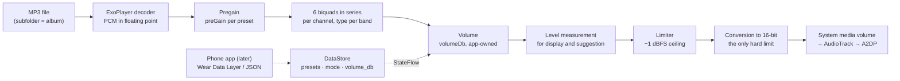
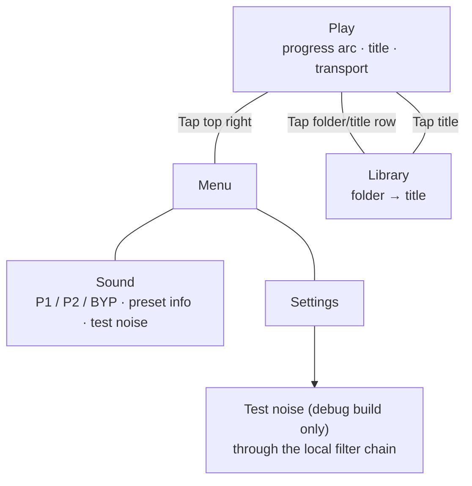

# NotchedMusic – Implementation plan: modes, 6-band EQ, library, player interface

> **Status: Historical draft, largely implemented.** This document describes the
> Original Watch design (two presets, four filter types, five pages). The current status
> (11/13/2026) is **three presets, seven filter types, true phone sync**; the deviations and
> The verified status can be found in Section 12 and in `PROJECT_STATUS.md`. Section 11 is
> continues the list of clarified or open questions.

Initial situation (is finished and measured): Wear OS module, `MediaSessionService` with ExoPlayer,
Background playback survives screen OFF (verified on emulator), dark OLED scheme
(5.3% bright pixels, default ≤ 15%), notch filter chain at 4.6 ns/sample (3 bands, 48 kHz, stereo).

Newly requested: 2 saved EQ presets + bypass as a third choice, up to 6 freely parameterizable ones
Filter per preset (lowshelf/highshelf/peak/notch, frequency accurate to Hz, Q, gain), setting screen,
recursive library with folders (albums), detailed player interface, volume, all without
Buffer underruns and no audible ringing.

---

## 1. Sound path – what it looks like later



**Why nothing can override internally:** comma numbers are used between decoder and limiter
calculated. Comma numbers have no limited range - an intermediate value of +40 dB is one
completely normal number, no error. Overcontrol is only physically possible where the
Comma number must be an **integer** (16 bits). That's why the entire level technology is *in front*
this one place:

| stage | Belongs | Task |
|---|---|---|
| Pre-gain `preGainDb` | **Preset** (Phone App) | compares presets with each other; compensates for the notch lowering |
| **Volume `volumeDb`** | **Watch** (DataStore) | the app's receiver control: turns everything down together before the conversion occurs - the crown operates it |
| Level measurement + limiter | Watch, automatic | measures the deflection, intercepts residual peaks, reports permanent limiting |
| Conversion to 16 bit | Watch | the only hard limit in the digital part |

Behind this, the **system media volume of the watch** still works - after the conversion, i.e. outside
our chain. It can no longer repair overdrive, only make it quieter. Recommendation as
One-time note in the settings: Leave the system volume high (~80%) and **via our
Control app volume** - this works before the conversion and is therefore the clean way.

> [!IMPORTANT]
> **Three levels, three responsibilities - that's why the preset doesn't need a fourth.**
>
> | Level | Works | Remembers | Responsible for |
> |---|---|---|---|
> | `preGainDb` (in preset) | in the chain, before the EQ | Preset / Phone App | Align presets (sound design) |
> | `volumeDb` (on the watch) | in the chain, after the EQ, **before** the conversion | our DataStore | Prevent clipping + listening level; Krone and Bluetooth access this |
> | System media volume | according to our chain | the system, per Bluetooth device | Rough grading for the ear |
>
> The reason for `volumeDb` in the app instead of just the system volume: against the conversion
> 16 bit no controller helps anymore - once a value is cut off, there is distortion
> already there. Your own level is also independent of the system and headphones and survives them
> Change and can be sent later from the phone app **with** the preset values, without the> Touch the user's system volume.
>
> **And because it has to be “simple”: the limiter works fully automatically.** It prevents
> Cutting without a single movement. The volume can only be lowered manually if the
> Limiter works continuously (then it sounds pressed for a long time). The surface shows live
> the deflection and offers "−2 dB" with **one tap** for permanent limiting. No menu,
> no controller wandering, no calibration page.

## 2. Digital filter – the conscious technology decision

**The basic building block remains the Biquad (2nd order, Transposed Direct Form II).** For all four required
There are exact RBJ formulas for filter types; each filter costs 5 multiplications per sample and
4 additions – **no matter what type**. Six bands × 2 channels = 12 biquads ≈ **9 ns/sample**
48 kHz (extrapolation from the measured 3-band chain), which is **0.09% of a CPU core time**.

Regarding the “algorithm too simple” concern: the right step up is **not** one
FFT/convolution solution (“linear-phase EQ”). With a narrow notch it would have an impulse response of
several hundred milliseconds, requires buffers of 4–8 kB per channel and increases the CPU load
Orders of magnitude – exactly the opposite of what a watch needs. The first choice here is the IIR
Standard because it has ~0 latency and minimal load with the same effect.

What really improves the quality instead (and what is now missing):

| point | Today | Planned |
|---|---|---|
| Coefficients | replaced immediately when changing presets → **cracking possible** | Smooth crossfading over 128 samples (coefficient interpolation), no click when controlling on the cell phone |
| Condition/calculation accuracy | `float` state, `double` coefficients | stays that way (demonstrably good for Q ≤ 30); **Test** checks for DC drift and increasing impulse response |
| Rounding the sample values ​​| Cut off | **decided: rounds** – practically free, see below |
| overload | hard clamp | **decided: limiter**, ceiling **−1 dBFS**, 1 ms attack / 50 ms release |
| Allocation in the audio path | Change working buffer is created per call | a fixed working buffer (max. buffer size), no new object construction in cycle |
| Ribbons | Notch-like over bandwidth | 4 types + `enabled` per band, `Q` direct, shelf edge optional |

### What rounds and limiters cost

**Rounding is free, not almost free.** The transition from comma number (filter) to integer
(Audio output) is always exactly one conversion command on the hardware; the difference is just
its rounding mode – truncation towards zero (today) against next value (planned, in Kotlin
`Float.roundToInt()`). The runtime converts both into the same command. We catch the upper limit
*before* the conversion in the decimal area (`coerceIn(-1f, 1f)`), this leaves the path without
Special branches. The benchmark also measures the conversion so that this does not remain an assertion. Conscious
**without** dithering: that would be a real additional calculation plus an audibly quiet noise - at
lossy MP3 material with no gain.

**Limiter: two multiplications, two additions, one comparison per sample** – roughly as much as
*half* a biquad, with 6 bands less than 4% added to the chain. Attack and release cost nothing
extra, they are just the smoothing constant. There is no clipping on bands up to +24 dB
Edge case more, but a condition that a preset with two or three overlapping lifters regularlyhits - and a distortion signal contains energy across the entire band, i.e. exactly in the area where
which the notch is supposed to quiet. Therefore two layers: the **validation** limits the
Sum boost of all bands together (max. +12 dB, runs once when changing a preset, never
per sample), the limiter with ceiling **-1 dBFS** remains the safety net, not the rule.

### Audible lingering – honest classification

> [!IMPORTANT]
> A narrow notch **must** blur in time - that's time-frequency blur, not
> Implementation error. The envelope decays with `Q/(π·f₀)`. At Q = 100 and 8 kHz this results
> around 27 ms decay; at Q = 8 it is ~2 ms and inaudible. Therefore:
> * **Q cap 30** (today 100) - wide notch, still very selective, but without smearing
> * Default setting Q = 4…8 for tinnitus notche
> * a test measures the decay time of the impulse response and compares it with theory - this is what it looks like
> you can limit cycles or increasing expenses immediately instead of hoping for them

> [!NOTE]
> **Latency is intentionally not a goal.** The device is a music player, not a phone – the chain has it
> no feedback path on which delay could be annoying. Therefore: no foresight
> Limiter, no linear phase filters, no deliberate buffer reduction. All
> Decisions below are in favor of **computational effort, memory and battery**, never in favor
> of latency.

### Filter data format (also the Bluetooth protocol)

```json
{
  "version": 2,
  "preGainDb": -6.0,
  "bands": [
    { "type": "NOTCH",     "frequencyHz": 7300.0, "q": 8.0,  "gainDb": -24.0, "enabled": true },
    { "type": "LOW_SHELF", "frequencyHz":   90.0, "q": 0.71, "gainDb":   -3.0, "enabled": true }
  ]
}
```

* `type`: `LOW_SHELF | HIGH_SHELF | PEAKING | NOTCH` (Reserve: `LOW_PASS`, `HIGH_PASS`)
* `frequencyHz` as `Double`, display integer in Hz (phone can be entered exactly, watch rotates roughly)
* `q` directly (display help: “corresponds to 912 Hz bandwidth”), range 0.1 … 30
* `gainDb` range **±24 dB** per band (requirement ±20 plus air), pre-gain ±12 dB
* **`volumeDb` (listener volume) is deliberately not in the preset** - it belongs to the watch
  (Section 1): The phone app should send the sound, but never over the user's neck
  adjust its volume
* `enabled` per band: Phone can mute a band without deleting it
* **max. 6 bands** - validating cuts off excess, audio path never throws

`bypass` moves out of the preset into **mode** (see 3) - a preset only describes
the sound, not the switch position. This is clearer for the Phone app.

## 3. Modes and storage

```kotlin
enum class FilterMode { PRESET_1, PRESET_2, BYPASS }
```

**Exactly one preset is always effective** - P1 and P2 are not stacked. `BYPASS` → chain without
Bands (volume and limiter remain active - listening level never changes when switching).

Because more than two presets are possible later, they are **not** stored as two fields,
but as an **ordered collection with identifier** (`PresetStore: Map<PresetId, FilterPreset>` plus
order). A third preset is then just a new entry – mode list, database
The key and the phone interface remain unchanged.

* **DataStore Preferences** (dependency is already in the project), key: Presets as JSON,
  `mode`, `volume_db`, `display_keep_awake`, `last_synchronized`
* **`volume_db` is our listening level** (Section 1): one level for everything, regardless of system and
  Headphones, survives device changes. We **do not** save the system media volume - that
  is in the best hands with the system (it remembers its level per Bluetooth device)* A source of truth: `AudioState(preset, mode, flags)` as `StateFlow`; `FilterSettings` becomes
  from a handcrafted `object` to a repository encapsulated location
* The audio path still only reads a `@Volatile` field - DataStore IO never happens in the audio thread
* First start: P1 = proven standard (notch 8 kHz), P2 = empty, mode = P1

## 4. Library: root folder with albums

The Music folder is the watch's **private app folder** - Wear OS doesn't have one
Permission dialogs, so this is the only way without a system media library:

```
/sdcard/Android/data/de.notchedmusic.watch/files/Music/     ← root
├── 2024-03 Notch 7,3 kHz/                                   ← album (subfolder)
│   ├── 01 - Morning.mp3
│   └── 02 - Evening.mp3
└── single-track.mp3                                           → collected in the “Root” folder

// Deeper subfolders inside a folder (e.g. Extra/Rain.mp3) do not create
// their own album – their files belong to the surrounding album.
```

Install on the watch (the emulator and any connected watch, USB or WiFi debugging):

```
adb push "C:\Music\2024-03 Notch 7,3 kHz" "/sdcard/Android/data/de.notchedmusic.watch/files/Music/"
```

Then click **Reload** in the app. In Android Studio you can do the same thing graphically via the window
**Device Explorer**. The TicWatch is not a USB mass storage device and MTP is not available on Wear OS –
later the phone app can send files via the data layer route (note the size limit).

Scan:
* **A folder directly under the root = an album**, done. No album tree, no second one
  level in the surface
* Within an album, **recursively flat counting** is used: subfolders below do not create any
  own albums, their files belong to the album (order: numbering, otherwise name)
* File names like `01 - Morning.mp3` → title “Morning”, sort index 1; otherwise alphabetically
* Files loose in the root do not go to waste: they collect in the “Root” folder
* Ignore hidden (`.filename`); Protection against fault trees: max. 6 levels, max. 2,000
  Files, max. 200 albums. Scan to `Dispatchers.Default`, exactly **one** pass per
  “Reload” – when switching to the background, it never scans
* **no** `MediaMetadataRetriever` loop (an expensive opening per file, just for a number in
  a list that no one reads). The running time of the current piece comes free of charge
  Players - that's why it's only on the game page

## 5. Surface - five sides, one ring, one crown

Guardrails: 466 × 466 round, OLED (≤ 15% bright pixels - measurable, see 8), swipe from the left
Edge = back, one hand, brief glances.

**The TicWatch 5 Pro has exactly one crown: it can be rotated in a grid pattern and can also be pressed.**
This results in the operating hierarchy - and it is better than any touch gesture:

| Input | On Lists (Library, Sound, Settings) | On the game page |
|---|---|---|
| **Rotate crown** | scroll through the list as usual (system behavior, we don't change it) | **Volume** (1 grid = 1 level) |
| **Press crown** | Keep system behavior (back) | Leave unchanged – do not reassign |
| Touch | tap, drag, hold | like right |

One rule for everything: **the crown operates the main controller of the respective side** – on lists that
Scrolling (unchanged system behavior, this is how every Wear app works), on the game page
Volume. There's nothing to scroll there anyway, so there's no conflict.

> [!NOTE]
> **There is no forward searching within a piece.** Jumps are only back/forward
> and folder back/next. This saves us search sliders, position setting, a switching mode for
> the ring – and with it a lot of condition and calculation work. The progress sheet becomes pure
> Advertisement.



### Play Page (Home Page)

```
        ⌚ 10:24            ← TimeText (system, ambient-capable)
   [ P1 ▾ ]              ☰     ← mode button · menu
      ╭─────────╮
    ╱  ●━━━━○      ╲      ← arc = pure progress indicator (not interactive)
   │  Morning       │         center: title (2 lines)
    ╲ 3 · 12 / 7 · 3 ╱       below: “Title 3 of 12 · Folder 3 of 7”
      ╰─────────╯          ← rotate crown here = volume
     ⏮      ⏯      ⏭       ← bar at the bottom of the arc
```

Service (deliberately short because the watch doesn't forgive a menu):

| gesture | Effect |
|---|---|| **Rotate crown** | **Volume**, 1 grid = 1 level; short fade-in `────●── 12` |
| **swipe on the arc | the same, for the hand without a crown |
| **⏯** | Play/Pause |
| **⏮ / ⏭** | Title back / forward (at the end of the folder continue into the next folder) |
| **⏮ / ⏭ hold** | **whole folder** back/forward – display “Folder 3 of 7 · 12 titles” |
| **Mode button** tap | Switch through P1 → P2 → BYP |
| **Hold mode button** | Bypass **only pressed for as long as possible** – the A/B comparison for a quick listen |
| Tap title/folder line | to the library |
| Swipe from edge | back (Menu/Library) |

> [!NOTE]
> The arc is **display, not a slider**: it shows where we are in the piece and has none
> Touch surface. Intent – a knob that looks like a display is the most common
> Source of error on 466 pixels. It is operated via buttons and crown, and both are unique.

> [!TIP]
> Crown volume can be checked immediately on the **emulator**: simulator buttons and mouse wheel provide
the same shooting events. The overlay shows the level - so you can see the effect even without it
> Sound as long as the headphones are still missing.

### Library page

Two levels, no tree structure:

1. **Folder list** – Header “7 folders · 84 titles”, folder name per row plus small underneath
   “12 tracks”; the current folder has an accent outline. Crown scrolls, tap opens.
2. **Title list** of the folder - index + title, the current track highlighted (and
   anautomatic-scroll to it when the page opens). Tap plays and returns
   "Play" back.

Why list *and* buttons: the buttons on the game page are a quick one (“next
folder"), the list answers the other question - **which folders actually exist and where am I
I just**. Both together are cheaper than a menu that you have to memorize.

### Sound page

* Three-segment switcher **P1 · P2 · BYP** (self-drawn, dark fill, accent border
  around the active segment)
* One card per preset: "P1 · 4 bands · deepest: Notch 7 300 Hz" plus "Edit via smartphone"
* **Test noise** – only visible in the debug build (section 7b): white noise, caused by your own
  Filter chain sent. This means you can hear each band as a “hole” in the noise, without a phone app and without
  Music file
* Button is a hold button: as long as it is pressed, there is a noise - no state of its own, none
  Danger of it staying on

### Settings Page

| Entry | What’s behind it |
|---|---|
| Bluetooth / Smartphone | Status ("connected · last takeover 2:02 p.m."), "takeover now", rejection reason for incorrect JSON |
| Display | **Switch: “Keep display awake while listening”** (`keepScreenOn`); “Show darkened” (own ambient display) |
| Audio | **Volume `volumeDb`** (our control, the same as on the game page), level/limiter
  Display with one-tap suggestion "−2 dB", pre-amplification of the active preset; a note below
  the system media volume of the watch (with jump there) |
| Library | Path (can be copied for typing via adb), title/folder number, “Reload” |
| Info | Version, last filter benchmark, “Reset to factory settings” |

> [!WARNING]
> **The app cannot set the system screen timeout** - that's one
> System Settings (Settings → Display). What we can control: `keepScreenOn` for ours
> Screens and your own, heavily darkened ambient display. The plan therefore only promises> the two points that are technically possible and linked to the system value in the settings.

### More UI rules

* One `AppScaffold` (in the activity), one `ScreenScaffold` per screen
* Navigation 3 with `rememberSwipeDismissableSceneStrategy()` (swipe = back, default feel)
* No area colors: night-dark fillings, highlighting via light font and 1 dp contours
* All values with a pop-up hint the first time (e.g. "Hold for folder"), then never again
* Rotation API: on lists the built-in scrolling of the `TransformingLazyColumn` (behaves with the
  crown correct by itself); on the game page there is a separate `ScrollableState` which sets the rotation
  Volume levels - there is nothing to scroll there, so no conflict
* No search function far and wide: no `seekTo`, no position target, no switching mode.

## 6. What else needs to be checked on the device

| Topic | Check | If no |
|---|---|---|
| Crown level fits? | 1 grid = 1 volume level, behavior on the real watch | Recreate steps in one place per grid |
| Crown pressure = system back? | Check behavior on the watch | leave unchanged, do not reassign |
| A2DP codec with the Amiron 3000 | Developer Options → Bluetooth Audio Codec | – (Coefficients are recalculated per sample rate, so it doesn’t matter) |
| 6 bands under load | 30 min playback, `dumpsys cpuinfo`, listening test for dropouts | Internally calculate tapes into blocks; continue to limit Q |
| App storage | `dumpsys meminfo` after 30 min: Heap is not allowed to grow (leak protection) | Find allocation points in the audio path |
| Battery | 60 min playback with/without “keep awake”, `dumpsys batterystats` | Making Ambient Presentation Harder |

## 7. Files at a glance

**dsp/** (pure mathematics, no Android types)
* `EffectBand.kt` **[new]** - Filter type enumeration, band, limits, validation, `maxBands = 6`
* `FilterPreset.kt` **[change]** - Format version 2 as above, without `bypass`
* `Biquad.kt` **[change]** - 4 types, coefficients in pairs (old → new) for blending
* `EffectChain.kt` **[new, replaces `NotchFilterChain.kt`]** - Biquads per channel, crossfade window,
  Pre-gain, limiter, fixed working buffer
* `Limiter.kt` **[new]** – no volume level: the watch takes care of it (section 1)
* `Pcm.kt` **[change]** - Rounds, not intermediate arrays
* `EffectAudioProcessor.kt` / `EffectAudioProcessorChain.kt` **[renamed, changed]** –
  `@Volatile preset`, `@Volatile volumeDb`, working buffer, reconfiguration when sample rate changes

**playback/**
* `FilterMode.kt` **[new]**, `SettingsRepository.kt` **[new, DataStore]**,
  `FilterSettings.kt` **[change]**, `PlaybackService.kt` **[change]** (sound state → processor,
  Log out if nothing is playing), `PlaybackController.kt` **[change]** (set/read `volumeDb` via
  the sound state – **not** via `AudioManager`; Skip tracks/folders using the
  album boundaries; **no** `seekTo`)

**data/**
* `MusicLibrary.kt` **[change]** - recursive, `Album(name, path, tracks)`, numbering, upper bounds

**ui/**
* `Navigation.kt`, `NavKeys.kt` **[new]**
* `screen/PlayerScreen.kt`, `screen/LibraryScreen.kt`, `screen/SoundScreen.kt`,
  `screen/SettingsScreen.kt`, `screen/MenuScreen.kt` **[new]**; `MainScreen.kt` **[omitted]**
* `components/ProgressArc.kt` (pure display, not usable), `VolumeOverlay.kt` (short display of the
  `volumeDb` level when turning the crown), `LevelMeter.kt` (level display + one-tap "−2 dB" atduration limit), `ModeSwitch.kt`, `TransportRow.kt`, `InfoChip.kt`, `HintHud.kt` **[new]**
* `debug/NoiseSource.kt` **[new, debug source]** - white noise as `MediaSource`, runs through
  the same path as music (decoder → EQ → limiter) instead of going past the chain
* `theme/Theme.kt` **[change]** - OLED outline colors, shapes; Screenshots as regression

**Tests** (JVM, run on PC)
* `BiquadResponseTest` - all 4 types: plateau gain, center frequency accurate to 1 Hz, Q ↔ width
* `BandStackingTest` - 6 bands of the same frequency add up as expected; `enabled` switches
  individually; Sequence exchange does not change the cumulative effect (independence)
* `CoefficientSmoothingTest` – preset change in the middle of the signal does not produce a sample jump > threshold
* `RingingTest` - impulse response decays with `Q/(π·f₀)`, never grows, no `NaN`/`Inf`
* `LimiterTest` - no clipping at 6 × +24 dB, attack/recovery without clicking noise
* `EffectChainBenchmark` **[replaces DspBenchmarkTest]** – 6 bands mixed, stereo, 48 kHz:
  Average **< 15 ns/sample** *and* worst single buffer < 1 ms (captures recalculation peaks)
* `AlbumScanTest` – a folder = an album, deeper subfolders count as the album, loose files in
  Root folders, numbering, hidden files, upper limits
* `AudioStatePersistenceTest` – mode/preset/volume survive “restart” (round trip through JSON)
* `OledPixelBudgetTest` **[Device test]** – every screen: bright pixels in the round screen ≤ 15%
* `NoiseSpectrumTest` – noise through the chain: with active notch measurably less energy in the
  Band than without (the listening test also has numerical proof)

##7b. Debug-only tools – historical draft, now deleted

> This section describes the previous plan. The test noise including `diagnosis/` sources and
> `NoiseWavTest` has been removed; the app no ​​longer includes debug noise tools.

The desire “only as long as we test” requires a technical limit that does not lie with humans.
Therefore three layers, from cheap to waterproof:

| layer | Implementation | Effect |
|---|---|---|
| 1. Source | Code in `app/src/debug/kotlin/…` instead of `main/` | does not exist in the release build - the compiler simply does not know the classes |
| 2. Access | Interface (e.g. `DiagnosticTools`) in `main/`, implementation only in `debug/`; Depending on the construction variant, the app starts with the real or an empty implementation through | UI code remains translatable in both builds, release gets the empty variant |
| 3. Advertisement | `BuildConfig.DEBUG` controls the button on the Sound page | in the release build the entry is invisible |

Required: `buildConfig = true` in the `buildFeatures` block. This function is available in AGP 9
**off by default** and is currently set to `false`; The class is only created with `true`
`BuildConfig` with its `DEBUG` field (AGP-9 documentation confirms exactly this way). Own fields would
entered via the new `BuildConfigField` API - we don't need it here.

**What belongs in this layer:** the test noise - and in the future everything else that is just that
Re-measurement is used (level curve output, forced sample rate change to check the
recalculation, preset rejection protocol). The regular route remains unaffected.

> [!IMPORTANT]
> **The noise runs through the same chain as the music** - as its own `MediaSource` in the
> service, not as a separate audio path. If you pass it past the filter chain and directly onto it> audio output, the listening test would be worthless: you would then hear the noise unchanged.

> [!TIP]
> Noise instead of sine curve is the better choice for notche: white noise contains all of them
> Frequencies at the same time, each active band appears as a “hole” – and with six bands
> and you can hear them all at once instead of going through them one after the other.

## 8. Order of implementation

| # | step | Result/Proof |
|---|---|---|
| **A** | DSP expansion: 4 filter types, Q, gain, 'enabled', 6 bands, crossfade, limiter, rounding | all DSP tests green, benchmark below limit, **no UI touched** |
| **B** | Library: one folder = one album, subfolders flat counted + tests | Folder structure visible on the emulator |
| **C** | DataStore, `FilterMode`, wiring up to the service | Switching P1/P2/BYP audibly/conceivably changes the sound, survives reboot |
| **D** | Navigation + five screens, crown = volume, transport including folder jump | complete operation with one hand, OLED budget test green |
| **E** | Settings (keep awake, library path), preset import via file (`adb push`),
  Test noise in debug build | Presets can be created without a phone app; A/B comparison and listening test
  of the EQ can be used |
| **F** | Prepare phone interface (listener + capability + JSON adoption) and measure on the real watch (codec, battery, load) | Protocol is in place, measured values ​​documented |

> [!TIP]
> Step A is intentionally first and alone: The filter math can be done on the PC
> recalculate (frequency response, decay time, no-click) – more precise than listening. Once A is established, B–F are mechanics.

### Resource budget – the firm commitments

No “optimize it later”, but rather criteria according to which each step is considered finished:

| Area | Commitment | As tested |
|---|---|---|
| CPU in audio path | 6 bands stereo **< 15 ns/sample** (≈ 0.09% of a core), worst single buffer **< 1 ms** | `EffectChainBenchmark` on every build |
| Allocation | **null** New object construction per audio buffer: fixed working buffer, no intermediate arrays, no boxing in the loop | Benchmark on Allocation Counter + Code Inspection |
| Storage | stable heap size during continuous operation (size dependent only on the library) | `dumpsys meminfo` before/after 30 min |
| Storage Library | List models only contain name + path (no file object, no metadata object) - 2,000 titles remain in the single-digit MB range | `AlbumScanTest` with artificially large list |
| Files/Storage Reads | exactly **one** directory pass per “reload”, no metadata loop, no scanning to the background on app start | Counters in scan test |
| Wake-up timer | Display ticker **only** when `isPlaying` **and** only when a UI is connected; no ticker if nothing is running | existing ticker + new test for unsubscribe |
| Composition | Playback state ends up in a `StateFlow`, only affected composables recompose (no "whole page repaints" per second) | Recomposition counter in the device test |
| Wakelocks / Services | only the one legitimate foreground service; at stop is released and the service ends | `dumpsys activity services` |
| Display | ≤ 15% bright pixels, no continuous animations, no progress rings every second | `OledPixelBudgetTest` |

> [!IMPORTANT]
> The biggest lever is still the screen, not the calculation work: the filter needs one> Second of music under half a millisecond CPU. A bright screen second costs one
> Multiples of this. That's why "awake behavior" and dark surfaces are more important in the plan
> planned as every micro-optimization of the filter calculation.

## 9. Deliberately different from the request

| request | Plan | reason |
|---|---|---|
| Q freely selectable | Q to 30 | Above this the notch audibly smears (section 2) |
| “Set screen time” | `keepScreenOn` + own ambient display | System timeout is blocked for apps |
| “Folder forward/backward” as the only folder choice | additional folder list | List shows *which* folders there are and where you are currently - that's exactly what the request wanted
| Subfolders as separate albums | **a** folder under the root = an album, including deeper subfolders | flat list is quicker to use on the watch; exactly as desired |
| Search in the piece | **no** search, just title and folder jump | desired; desired saves `seekTo`, search slider, ring switching and their state |
| Edit presets on the watch | read on the watch, edit on the phone | 4 values ​​× 6 bands per rotating ring is torture; Import file bridges to the phone app |
| Volume only via the system | **own `volumeDb` in the app** (crown turning), system volume also remains there | only a control *before* the conversion to 16 bits can prevent overdriving; your own level is independent of the system and headphones and survives device changes |
| own gain value in the preset | Preset contains only `preGainDb`; the hearing level is on the watch | otherwise a preset from the phone would secretly adjust the user's volume |

## 10. What stays the same

Playback on service, background operation, 16-bit PCM path, no network, no offload (filter is
Permanent state), dark color scheme, app runs independently without a phone app.

## 11. Open questions

1. ~~Rotary encoder~~ **clarified:** a gridded, rotatable, pressable crown. Turning is primary
   Operation (lists: native scrolling; game page: volume in steps), pressing remains
   System behavior.
2. ~~Playing time~~ **decided in terms of resource requirements:** no playing time in the lists
   (otherwise one metadata opening per file). The current term comes free of charge from the player
   condition and is only available on the game page.
3. ~~Test tone~~ **clarified and changed:** no sine-wave tone, but **test noise**, and only in
   Debug build (Section 7b).
4. **Album Granularity:** Subfolders directly under the root as album (planned), or the
   complete path as album name (`Klassik/2019/…`)?
5. ~~Stack presets?~~ **clarified:** exactly one preset is always effective, P1 and P2 are not stacked.
   The file is already stored as a collection so that a third preset is not a conversion later.
6. **New, decided by the latency statement:** The crown controls search in **5 seconds** and
   Volume in **1 dB increments** per grid. Other increments? (Only the number in
   `RotarySensitivity`, no conversion.)

---

## 12. Implementation status November 13, 2026 (revision)

This document is the original draft; A common status has now been implemented
the phone app. `PROJECT_STATUS.md` is binding.

### What has changed from the draft

| point | Draft | Implementation |
|---|---|---|
| Presets | P1 · P2 · Bypass | **Off · P1 · P2 · P3**; always exactly one state, never stacked || Filter Types | 4 (Shelf/Peak/Notch) | **7**: `OFF`, `NOTCH`, `PEAKING`, `LOW_SHELF`, `HIGH_SHELF`, `LOW_CUT`, `HIGH_CUT` |
| Preset maintenance | File import, later Phone | **phone only**; the watch does not have a band editor |
| Phone connection | Listeners prepared | **real data layer sync** with capability, ACK, manifest, assets and commit |
| Music Sync | additive/overwriting | **Mirror**: unselected titles will only be deleted after a confirmed commit |
| Library | five pages, menu | Navigation 3: **Albums · Titles · Players · EQ · Settings**; no covers |
| Volume | App-own `volumeDb` | remains; Crown/touch controls them, preset sync never adjusts them |
| Test noise | Debug build planned | **deleted** – debug tools and test removed; no noise file in the app |

### Verified device acceptance

* **Pixel 10 ↔ TicWatch Pro 5, real devices:** Presets (P1/P2/P3) arrived and were confirmed;
  Music (2 MP3s, 396 KB) was mirrored and committed; a mirror delete removed
  the unselected track on the watch.
* **Build/Test:** `app:assembleDebug` green, **139/139 JVM tests**, `app:lintDebug` 0 errors;
  Benchmark **11-14 ns/sample**, worst buffer **< 0.1 ms** (host load dependent; last
  Single run 11.054 ns / 0.097 ms).
* **Special features that will save time next time:** DataItems `setUrgent()`; Assets about the
  address Play-Services-Digest (`audio_digest`, Base64-SHA-1); `applicationId` of both APKs is
  `de.notchedmusic.phone`; the watch receivers are `enabled="false"` in the manifest and are controlled by
  `SyncReceipt` only opened when the app is open or data is running (90 s delay) - a boost from
  The phone needs the watch app to be open; Process recipients synchronously in the callback and in the app-wide scope
  hold.

### Still open

* Instrumented Compose/UI testing; 10 file run, large file, abort **mid-upload**,
  Memory shortage and invalid preset as real E2E cases; 30 minute A2DP and
  OLED measurement on the watch and the app icon; the personal release is built and installed.