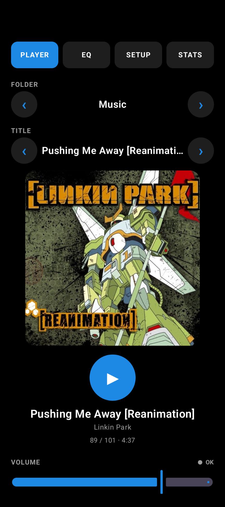
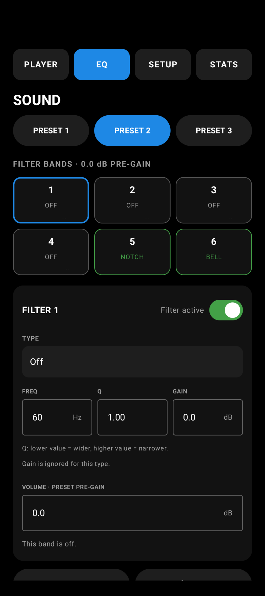
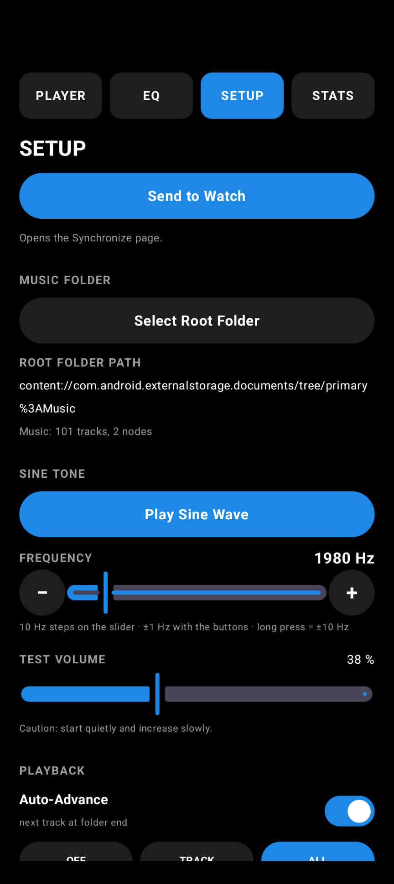
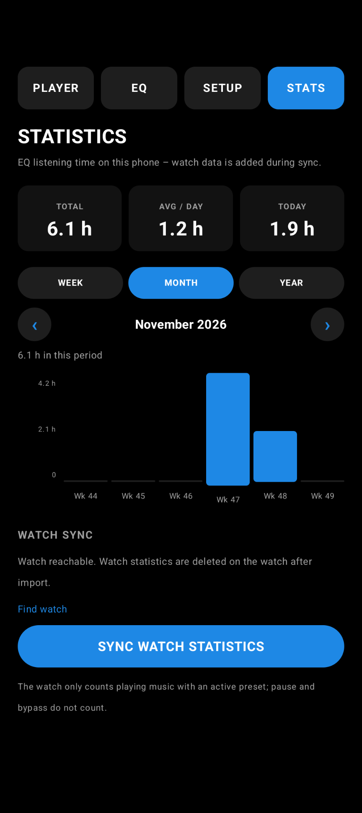
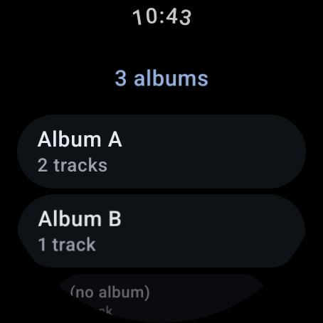
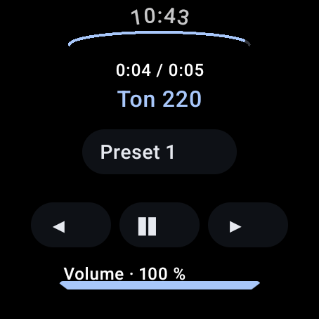
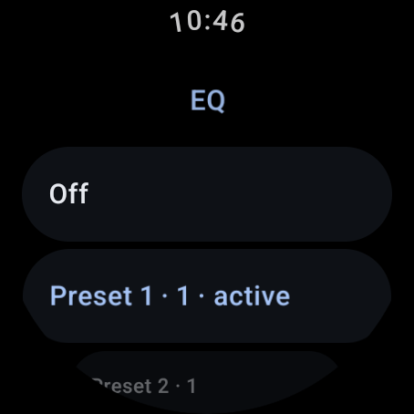
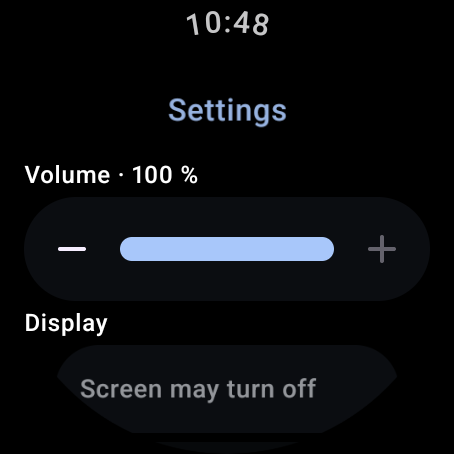

# NotchedMusic

**An Android music player for tinnitus retraining through notched music listening, with a unique
Wear OS app that plays mirrored music standalone using the same real-time notch filtering as the
phone app.**

NotchedMusic is a focused, offline music player built around a real-time notch-filter equalizer.
It plays a listener's own library while shaping the audio around a narrow frequency region, and
mirrors selected music and EQ presets to a companion watch. The project is intended for personal
tinnitus retraining sessions, not for general-purpose music streaming.

> **Medical notice:** NotchedMusic is not a medical device and does not diagnose, treat, or cure
> tinnitus. It is a personal listening tool. Consult a qualified medical professional for
> tinnitus management, and stop listening if sound becomes uncomfortable or painful.

## Overview

The repository contains two Android applications that share the same package identity and signing
key:

| Component | Target | Role |
|---|---|---|
| **NotchedMusic Phone** | Google Pixel 10 / Android 17 (API 37) | Library, playback, DSP/EQ editing, watch sync, listening statistics |
| **NotchedMusic Watch** | TicWatch Pro 5 / Wear OS 4 (API 33) | Unique standalone playback of mirrored music with its own real-time DSP/notch filtering, preset selection and local listening time tracking |

The phone app is the library master. It scans a music folder selected through Android's Storage
Access Framework, applies the notch-filter DSP in the playback pipeline, and sends presets and
mirrored audio files to the watch over the Wear Data Layer. The Wear OS app is not a remote
control: it plays the mirrored library entirely on the watch, applies its own real-time notch
filtering locally, and hands EQ listening statistics back during the next sync. It therefore works
without the smartphone nearby.

## Screenshots

### Phone app

<table>
  <tr>
    <td align="center"><a href="NotchedMusic-Phone/docs/screenshots/Screenshot_phone_player.png"></a><br><b>Player</b><br><sub>Album cover, title, transport and volume</sub></td>
    <td align="center"><a href="NotchedMusic-Phone/docs/screenshots/Screenshot_phone_eq.png"></a><br><b>EQ</b><br><sub>Three presets and six real-time filter bands</sub></td>
    <td align="center"><a href="NotchedMusic-Phone/docs/screenshots/Screenshot_phone_setup.png"></a><br><b>Setup</b><br><sub>Library, sine-tone test and playback options</sub></td>
    <td align="center"><a href="NotchedMusic-Phone/docs/screenshots/Screenshot_phone_stats.png"></a><br><b>Statistics</b><br><sub>EQ listening time and week/month/year charts</sub></td>
  </tr>
</table>

### Watch app

<table>
  <tr>
    <td align="center"><a href="NotchedMusic-Watch/docs/screenshots/Screenshot_watch_albums.png"></a><br><b>Albums</b><br><sub>Locally mirrored library and album navigation</sub></td>
    <td align="center"><a href="NotchedMusic-Watch/docs/screenshots/Screenshot_watch_now_playing.png"></a><br><b>Now playing</b><br><sub>Standalone playback with preset and volume</sub></td>
    <td align="center"><a href="NotchedMusic-Watch/docs/screenshots/Screenshot_watch_eq.png"></a><br><b>EQ selection</b><br><sub>Off and the three phone-edited presets</sub></td>
    <td align="center"><a href="NotchedMusic-Watch/docs/screenshots/Screenshot_watch_settings.png"></a><br><b>Settings</b><br><sub>Volume, display, phone status and storage</sub></td>
  </tr>
</table>

The watch screenshots were captured on the Wear OS Large Round emulator (API 33). The watch is a
standalone player: it applies the same real-time notch filtering locally, without streaming audio
from the phone.

## Core features

- **Notched music listening** — three editable EQ presets with six bands, notch filters, preamp,
  bypass mode and a clipping indicator.
- **Real-time DSP** — biquad filter chain and stereo limiter running directly in the Media3 audio
  sink, with fixed working buffers and no allocations in the sample path.
- **Local library playback** — SAF-based folder access, recursive scanning, album/artist covers,
  natural sorting, repeat modes and auto-advance.
- **Unique standalone watch player** — preset sync and SHA-256-verified music mirroring over the
  real Wear Data Layer; the watch plays mirrored files locally with its own real-time DSP and notch
  filtering, without streaming from the phone.
- **EQ listening statistics** — total time, all-time average per day and week/month/year charts,
  with phone-side merging of watch reports.
- **Reliable background playback** — Media3 `MediaSessionService` manages the foreground service
  and media notification, so playback survives calls and screen locks.
- **Private by design** — no analytics, no account, no cloud storage; network access is limited to
  album-cover lookups.

## Repository map

| Path | Purpose |
|---|---|
| `NotchedMusic-Phone/` | Phone app, shared `:core` JVM module, DSP, sync protocol and tests |
| `NotchedMusic-Watch/` | Wear OS app, watch DSP, local statistics and Wear Data Layer receivers |
| `docs/` | English build, help and architecture documentation |

## Downloads and releases

Ready-to-install signed APKs are attached to the repository releases, so no development setup is
required:

- [**NotchedMusic v1.0.3 release**](https://github.com/denis-1337/NotchedMusic/releases/tag/v1.0.3)
  — phone 1.0.2 APK, watch 1.0.1 APK and SHA-256 checksums.

Download the phone APK and the watch APK and install them with Android's package installer. The watch app is a standalone player with its own real-time notch filtering; it does not
need the phone nearby for playback. A release also includes the current compiled APK binaries for
users who do not work with Android Studio or Gradle.

The release is private together with the repository. Signing keys, build outputs and local test
media are never uploaded.

## Documentation

- [**Help — using NotchedMusic**](docs/HELP.md): first setup, playback, EQ, watch sync,
  statistics and troubleshooting.
- [**Build and deployment**](docs/BUILD.md): local build, tests, signing and device installation.
- [**Releases and APK downloads**](docs/RELEASES.md): signed APK assets and normal installation.
- [**Architecture**](docs/ARCHITECTURE.md): modules, data flow, sync protocol and persistence.

Project-specific technical logs are kept in the two project folders:

- `NotchedMusic-Phone/README.md`
- `NotchedMusic-Phone/PROJECT_STATUS.md`
- `NotchedMusic-Watch/README.md`
- `NotchedMusic-Watch/PROJECT_STATUS.md`

## Quick start

Requirements: JDK 17, Android SDK with platform 37 and build-tools 36+, plus a connected phone or
Wear OS device for installation.

```bat
cd NotchedMusic-Phone
gradlew.bat :core:test :app:testDebugUnitTest
gradlew.bat :app:assembleDebug :app:lintDebug

cd ..\NotchedMusic-Watch
gradlew.bat app:testDebugUnitTest app:assembleDebug app:lintDebug
```

A locally signed release APK can be produced with the procedure in
[`docs/BUILD.md`](docs/BUILD.md). Build outputs and signing material are intentionally excluded
from Git.

## Verification status

- **Phone unit tests:** 102 tests, 0 failures.
- **Watch unit tests:** 150 tests, 0 failures.
- **Lint:** Phone clean; watch with 0 errors (only dependency/version warnings).
- **Real hardware:** tested on a Pixel 10 (API 37) and a TicWatch Pro 5 (API 33), including real
  Wear Data Layer preset/music sync and EQ statistics transfer.
- **Background playback:** call/hang-up path verified on the emulator; screen-lock path verified on
  the real Pixel 10 with signed release APKs. Version 1.0.1 additionally restores a missing playback
  service before playback, so screen-lock protection also applies after a locked install or a
  service restart.
- **User interface:** the complete phone and watch UIs are English; all labels, status messages,
  chart labels and date formats were translated. The phone UI was checked on the real Pixel 10 and
  on the API 37 emulator; the watch UI was checked on the Wear OS Large Round emulator.

## Roadmap

- Add a German language switch in the Setup menu, with **English as the default**.
- Finalize the English help pages.
- Add instrumented Compose UI tests for sync, player and EQ fields.
- Complete the large-file-at-limit, abort/storage-shortage, 30-minute A2DP/OLED and icon checks.

## Privacy and online behaviour

NotchedMusic does not collect analytics, create an account or upload listening data. Album covers
may be fetched from MusicBrainz/Cover Art Archive and the iTunes Search API when a track has enough
metadata; only title, artist and album are sent. No file paths or listening history leave the
device. Without network access, a placeholder cover is shown.

## License

NotchedMusic is licensed under the Apache License, Version 2.0.
You may use, modify and redistribute the code and documentation under the terms
of that license. See `LICENSE` for the full text and `NOTICE` for third-party
components and attributions.
