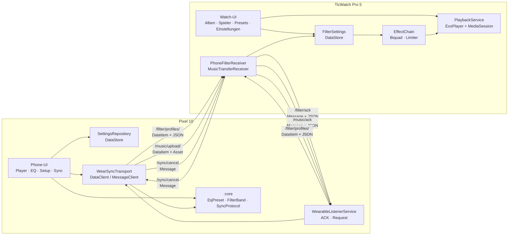

# NotchedMusic – Gemeinsamer Umsetzungsplan Phone ↔ TicWatch Pro 5

**Stand:** 13.11.2026  
**Projekte:**  
- Phone: `Z:\android_projekte\NotchedMusic\NotchedMusic-Phone` (`de.notchedmusic.phone`)  
- Watch: `Z:\android_projekte\NotchedMusic\NotchedMusic-Watch` (`de.notchedmusic.watch`)  
**Zielgeräte:** Google Pixel 10 (Android 17 / API 37) und Mobvoi TicWatch Pro 5 (466 × 466, rund, OLED)  
**Umsetzungsstand:** 13.11.2026 – Phasen 1–5 umgesetzt und auf Pixel 10 ↔ TicWatch
Pro 5 für Preset- und Musik-Sync abgenommen; Phase 6 (vollständige E2E-Matrix,
UI-Tests, OLED/Akku) ist teilweise offen. Details: Abschnitt 12 sowie die
`PROJEKTSTATUS.md`-Dateien beider Projekte.  
**Revision:** 13.11.2026 – Entscheidungen zu Musik-Spiegel, Watch-Umfang und App-Reset eingearbeitet.

---

## 0. Kurzfassung

Die Phone-App ist funktional fertig und auf dem Emulator abgenommen. Der einzige fehlende
Funktionsblock ist die echte Kommunikation mit der Uhr; derzeit läuft dort ein Mock.
Die Watch-App ist ebenfalls gebaut und getestet, hinkt aber beim Datenmodell und beim
Sync-Protokoll hinterher: Sie kennt **zwei Presets (A/B)** und **vier Filtertypen**, die Phone-App
verwaltet **drei Presets (P1/P2/P3)** und **sieben Filtertypen** (inkl. `OFF`, `LOW_CUT`,
`HIGH_CUT`).

Dieser Plan bringt beide Projekte auf denselben Stand, implementiert den echten Sync über die
**Wear OS Data Layer** (Bluetooth/WLAN, kein eigener Bluetooth-Stack) und optimiert die
Watch-Oberfläche für die TicWatch Pro 5. Getestet wird auf beiden echten Geräten, auf den
vorhandenen Emulatoren und mit JVM-/UI-Tests.

### Verifizierter Ausgangsstand (13.11.2026)

| Prüfung | Ergebnis |
|---|---|
| Phone-Build | `BUILD SUCCESSFUL` |
| Phone-Tests | **68 / 68 grün** (`:core` 55, `:app` 13), 0 Fehler |
| Watch-Build | `BUILD SUCCESSFUL` |
| Watch-Tests | **108 / 108 grün**, 0 Fehler |
| Pixel 10 real | Android 17 / API 37, 1080 × 2424, 47 GB frei |
| TicWatch Pro 5 real | Android 13 / **API 33** (nicht 34!), 466 × 466, 20 GB Speicher, 18 GB frei |
| Wear-Data-Layer | **funktioniert bereits**: Capability `de.notchedmusic.watch.filter_profiles` kam am 13.11. um 16:42 auf dem Pixel an |
| Kopplung | beide Geräte mit `supermuckl@gmail.com`, Wear-Companion auf dem Pixel aktiv, Watch per Bluetooth gepaart |
| Watch-App installiert | ja, seit 13.11. 16:41 (Version 1.0) |
| Phone-App installiert | ja, inkl. Debug-Build |

> **Wichtig:** Die echte Uhr meldet **API 33** (Wear OS 4). Der bisherige Watch-Status spricht von
> Wear OS 5 / API 34. Für Tests und Kompatibilität gilt die reale API 33; `compileSdk/targetSdk 37`
> und `minSdk 33` bleiben unverändert.

---

## 1. Ziel und Definition of Done

Nach Abschluss gilt:

1. **Preset-Sync:** Die Phone-App sendet alle drei Presets samt Namen, IDs, Vor-Verstärkung,
   sechs Bändern, Filtertypen und `enabled`-Zuständen an die Uhr. Die Uhr übernimmt sie vollständig,
   validiert sie und bestätigt den Empfang.
2. **Musik-Sync ist ein Spiegel:** Die Phone-Bibliothek ist Master. Die Uhr enthält nach einem
   erfolgreichen Musik-Sync **genau** die ausgewählten Titel; nicht ausgewählte bzw. auf dem Phone
   nicht mehr vorhandene Titel werden auf der Uhr gelöscht. Die Uhr spielt die Dateien autark ab.
3. **Drei Presets auf der Uhr:** P1, P2, P3 sind auswählbar; „Aus“ bleibt der Bypass. Es wird immer
   genau ein Preset oder Bypass wirksam, niemals eine Stapelung. Bearbeitet werden die Presets
   ausschließlich auf dem Phone.
4. **Sieben Filtertypen:** Die Uhr rechnet `OFF`, `NOTCH`, `PEAKING` (Bell), `LOW_SHELF`,
   `HIGH_SHELF`, `LOW_CUT` und `HIGH_CUT` mit denselben Parametern und Validierungsgrenzen wie die
   Phone-App.
5. **Keine stillen Datenverluste:** Ungültige Pakete werden protokolliert und abgelehnt, nicht
   halb übernommen. Die Uhr meldet Erfolg oder einen verständlichen Fehlergrund zurück.
6. **Verlässlicher Sync:** Fortschritt, Abbruch, Timeout, Retry, Speicherplatzprüfung und
   Wiederholung nach Verbindungsabbruch sind implementiert und getestet.
7. **Watch-GUI:** Die Uhr-Oberfläche ist auf 466 × 466, runde Form, OLED und Bedienung mit einer
   Hand optimiert. Sie zeigt Musik ohne Cover und bietet den EQ nur als „an/aus“ plus Presetwahl.
   Sie erfüllt das OLED-Budget (≤ 15 % helle Pixel) und ist auf dem echten Gerät abgenommen.
8. **Testabnahme:** Alle JVM-Tests, UI-Tests und der End-to-End-Test auf Pixel 10 ↔ TicWatch Pro 5
   sind grün. Die Messungen und Screenshots sind dokumentiert.

**Nicht Teil dieses Vorhabens:** Phone-GUI-Neubau (die vorhandene Oberfläche ist abgenommen),
Audio-Streaming von Phone zur Watch, eigener Bluetooth-Audio-Stack, Release-Signing/Store,
Cloud-Sync, Preset-Bearbeitung und Album-Cover auf der Uhr.

---

## 2. Die Lücken im Ist-Stand

| Bereich | Ist-Stand | Soll-Stand | Betroffen |
|---|---|---|---|
| Sync-Transport Phone | `MockSyncTransport`; sendet nichts | echter Wear-Data-Layer-Transport | `sync/*`, `AppGraph`, Manifest |
| Capability Phone | Phone meldet keine Fähigkeit | `de.notchedmusic.phone.sync` für die Watch-Anfrage | `NotchedMusicApp`, `PhoneLink` |
| Preset-Datenmodell Watch | 2 Slots A/B, eigenes `FilterPreset` | 3 presets p1/p2/p3, gemeinsames `EqPreset`-Format | `dsp/*`, `playback/*` |
| Filtertypen Watch | 4 Typen | 7 Typen inkl. OFF/Lowcut/Highcut | `Biquad`, `EffectChain`, UI |
| Preset-Empfänger Watch | liest `FilterProfiles` (2 Slots) | liest `PresetSyncPayload` v3 (3 Presets) | `PhoneFilterReceiver` |
| Musik-Sync Phone | simuliert nur | Asset-Upload aus SAF, Fortschritt, Abbruch | `sync/*` |
| Musik-Sync-Semantik | additiv/überschreibend geplant | Spiegel: ausgewählte Titel vorhanden, alles andere auf der Uhr löschen | `SyncRepository`, `MusicTransferReceiver` |
| Musik-Empfänger Watch | schreibt Dateien, aber ohne ACK/Reserveprüfung | atomar, prüfend, ACK, Speicherplatzprüfung, Refresh-Signal | `MusicTransferReceiver` |
| Album-Zuordnung | `track.album` ist oft der ID3-Albumname oder `null` | Ordnerstruktur der Uhr: Root = lose, direkter Unterordner = Album | `LibraryTrack`, `MusicScanner`, `SyncRepository` |
| Watch-Status | zeigt „zuletzt“ aus altem Slot-Modell | echter Verbindungs-/Sync-Status | `SettingsScreen`, `PhoneLink` |
| Watch-GUI | funktional, aber A/B-Layout und unnötige Tiefenbearbeitung | EQ an/aus, 3 Presets, Musik ohne Cover, klare Spielseite | `ui/*` |
| Dokumentation | Watch-Status sagt 86 Tests und 2 Presets | Stand 108 Tests, 3 Presets, Sync | `PROJEKTSTATUS.md`, `plan.md` |

---

## 3. Architektur

### 3.1 Datenfluss



Die Data Layer wählt selbst Bluetooth oder WLAN; die App baut **keinen eigenen Bluetooth-Stack**.
Das ist der von Wear OS vorgesehene Weg und funktioniert bereits nachweislich zwischen den beiden
realen Geräten.

### 3.2 Ein gemeinsames Preset-Format

**Entscheidung D1 (getroffen): Kopie.** Das ist eine reine Code-Organisationsfrage, keine
Funktionsfrage. Die Watch-App bekommt eine Kopie der Phone-Core-Klassen in das eigene Projekt:

- `EqPreset`, `FilterBand`, `FilterType`, `DefaultPresets`, `SyncProtocol`, `PresetSyncPayload`,
  `MusicUpload`, `SyncAck`, `MusicManifest`
- `Biquad`, `Limiter`, `Pcm`, `EqChain`

Damit bleiben beide Projekte getrennt und eigenständig baubar (kein Cross-Projekt-Pfad, keine
`includeBuild`-Abhängigkeit). Die Kopie wird durch **gemeinsame JSON-Fixtures und
Kompatibilitätstests** in beiden Projekten abgesichert. Wenn die Phone-Core-Klassen sich ändern,
muss die Watch-Kopie bewusst nachgezogen und der Fixture-Test angepasst werden.

**Nicht gewählt:** Ein gemeinsames Gradle-Modul `notchedmusic-core` außerhalb beider Apps. Das
wäre strukturell sauberer, erfordert aber einen Umbau beider Builds und eine neue
Projektstruktur. Das wird hier nicht gebraucht.

### 3.3 Watch-Zustandsmodell

Statt `FilterProfiles` mit `slotA`/`slotB` speichert die Uhr künftig:

```kotlin
@Serializable
data class WatchSettings(
  val version: Int = 2,
  val presets: List<EqPreset> = DefaultPresets.three(), // genau p1, p2, p3
  val activePresetId: String? = DefaultPresets.PRESET_1_ID, // null = Bypass
  val volumeDb: Float = 0f,                              // Hörpegel, nie vom Phone gesetzt
  val keepScreenOn: Boolean = false,
  val ambientDimmed: Boolean = true,
  val lastPresetUpdateMs: Long = 0L,
  val lastMusicUpdateMs: Long = 0L,
  val lastSyncError: String? = null,
)
```

- Genau drei Presets; überzählige werden abgeschnitten, fehlende mit den Standardrezepten
  aufgefüllt.
- `activePresetId = null` bedeutet **Bypass**. Es gibt keinen separaten `eqBypass`-Schalter auf der
  Uhr; die Auswahl „Aus“ ist der Bypass.
- `volumeDb` bleibt ausschließlich Eigentum der Uhr. Ein Preset-Sync verstellt niemals den
  Hörpegel.
- Die Phone-App sendet ihre drei Presets und `activePresetId`; die Uhr übernimmt standardmäßig
  **die Presets, aber nicht die aktive Auswahl**. Die aktive Auswahl des Uhren-Nutzers bleibt.
- Migration: Der bisherige Stand mit A/B wird beim ersten Start gelesen und auf p1/p2/p3 abgebildet
  (A → p1, B → p2, p3 = Standard); Lautstärke und Anzeige-Schalter bleiben erhalten.

### 3.4 Capabilities und Richtungen

| Gerät | Capability | Zweck |
|---|---|---|
| Watch | `de.notchedmusic.watch.filter_profiles` | Phone findet die Uhr |
| Phone | `de.notchedmusic.phone.sync` | Watch findet das Phone |
| Watch | Request `/filter/request` | „Gib mir den aktuellen Preset-Stand“ |
| Phone | DataItem `/filter/profiles/<id>` | Presets senden |
| Watch | Message `/filter/ack` | Empfang bestätigen / Fehler melden |
| Phone | DataItem `/music/manifest/<id>` | Soll-Liste für den Musik-Spiegel senden |
| Watch | Message `/music/manifest/ack` | Manifest bestätigen / fehlende Dateien melden |
| Phone | DataItem `/music/upload/<id>` | Musik senden |
| Watch | Message `/music/ack` | Datei bestätigen / Fehler melden |
| Phone | Message `/music/commit` | Spiegel freigeben: Löschen nicht ausgewählter Titel |
| Watch | Message `/music/commit/ack` | Löschung bestätigen |
| Phone ↔ Watch | Message `/sync/cancel` | laufenden Sync abbrechen |

Die bisherige Watch-Logik `PhoneLink.fordereProfileAn` fragt die **eigene** Capability ab und kann
deshalb ins Leere laufen. Das wird korrigiert: Die Watch fragt künftig
`de.notchedmusic.phone.sync` ab, das Phone meldet diese Capability in `Application.onCreate` an.

### 3.5 Musik- und Album-Zuordnung

Die Uhr hat eine flache Alben-Struktur:

- Dateien direkt im Musik-Root → Album `(ohne Album)`
- Dateien in einem direkten Unterordner → Album = Ordnername
- Dateien in tieferen Unterordnern → gehören zum direkten Unterordner (Album)

Die Phone-App liefert SAF-Titel rekursiv. Damit der Sync dieselbe Struktur erzeugt, bekommt
`LibraryTrack` ein neues Feld `watchAlbum: String?`:

- `null` für Dateien direkt im Root,
- Ordnername des direkten Root-Unterordners für alle Dateien darunter.

`MusicUpload.album` wird daraus gefüllt. Die ID3-Album-Metadaten (`track.album`) werden **nicht**
als Ablageordner verwendet; sie sind nur für Cover/Anzeige da – und auf der Uhr gibt es künftig
keine Cover.

Dateiendungen beider Seiten werden vereinheitlicht:
`mp3, m4a, aac, ogg, oga, opus, flac, wav`.

**Spiegel-Regel:** Nach erfolgreichem Commit enthält der Musikordner der Uhr genau die Dateien des
Manifests. Was nicht im Manifest steht, wird gelöscht – ausschließlich innerhalb des
App-Musikordners und ausschließlich Musikdateien. Der Haken auf dem Root meint „alles“; einzelne
Unterordner können zusätzlich gewählt werden. Die effektive Auswahl ist die Vereinigung der
Haken. Ist der Root gewählt, gelten alle Unterordner als enthalten; die Phone-UI deaktiviert dann
deren Haken, damit keine Mehrdeutigkeit entsteht.

---

## 4. Sync-Protokoll (v3-Payload + Sync-Envelope)

### 4.1 Presets

DataItem-Pfad (eindeutig durch `createWithAutoAppendedId`):

```text
/filter/profiles/<auto-id>
```

DataMap-Schlüssel:

| Schlüssel | Typ | Inhalt |
|---|---|---|
| `profiles_json` | String | `PresetSyncPayload` v3, max. 8 KiB |
| `sync_id` | String | UUID des Laufs |
| `sent_at_ms` | Long | Zeitstempel Phone |
| `phone_name` | String | z. B. „Pixel 10“ |
| `protocol` | Int | `3` = Preset-Payload-Version |

Payload-Inhalt bleibt das vorhandene v3-Format:

```json
{
  "version": 3,
  "presets": [
    {
      "id": "p1",
      "name": "Preset 1",
      "preGainDb": 0.0,
      "bands": [
        {
          "type": "NOTCH",
          "frequencyHz": 8000.0,
          "q": 8.0,
          "gainDb": -20.0,
          "enabled": true
        }
      ]
    }
  ],
  "activePresetId": "p1"
}
```

Die Uhr validiert mit `SyncProtocol.validate(payload)` und ersetzt alle drei Presets. Sie behält
`volumeDb`, den Anzeige-Schalter und ihre aktive Auswahl. Überzählige Bänder werden abgeschnitten,
ungültige Werte an die Grenzen geklemmt.

### 4.2 ACK

Die Uhr antwortet per `MessageClient.sendMessage` an den Node aus `dataItem.uri.host`:

```json
{
  "protocol": 3,
  "syncId": "…",
  "kind": "presets",
  "status": "APPLIED",
  "appliedAtMs": 1763050000000,
  "presetCount": 3,
  "watchVersion": "2.0",
  "error": null
}
```

Fehlerstatus: `REJECTED` mit `error` = `invalid_payload`, `too_large`, `unsupported_version`,
`internal_error`. Die Phone-App zeigt den Fehlertext verständlich an und wiederholt den Lauf nicht
blind.

### 4.3 Musik (Spiegel-Sync)

Der Musik-Sync läuft in drei Schritten: **Plan → Übertragung → Commit**.

#### Schritt 1: Manifest

DataItem-Pfad:

```text
/music/manifest/<auto-id>
```

DataMap:

| Schlüssel | Typ | Inhalt |
|---|---|---|
| `manifest_json` | String | Soll-Liste, max. 1 MiB |
| `session_id` | String | Sync-Lauf |
| `sent_at_ms` | Long | Zeitstempel Phone |

Manifest-Eintrag:

```json
{
  "album": "Album A",
  "fileName": "01 - Morgen.mp3",
  "sizeBytes": 5242880,
  "sha256": "…"
}
```

Die Uhr prüft das Manifest, speichert es als **ausstehend** (noch keine Löschung!) und antwortet
`/music/manifest/ack` mit `status`, `missingCount`, optionaler Ist-Liste und Fehlergrund. Enthält
das ACK die Ist-Liste mit Größe/SHA, überspringt das Phone identische Dateien; fehlt sie, werden
alle ausgewählten Dateien hochgeladen. Der Commit ist erst erlaubt, wenn jede Manifest-Datei
entweder hochgeladen oder als identisch bestätigt wurde.

#### Schritt 2: Datei-Upload

DataItem-Pfad:

```text
/music/upload/<auto-id>
```

DataMap:

| Schlüssel | Typ | Inhalt |
|---|---|---|
| `audio` | Asset | Audiodatei, `Asset.createFromFd(...)` |
| `session_id` | String | Sync-Lauf |
| `index` | Int | 0-basiert |
| `total` | Int | Anzahl Dateien |
| `file_name` | String | Dateiname inkl. Endung |
| `album` | String? | Watch-Album; `null` = `(ohne Album)` |
| `mime_type` | String? | tatsächlicher MIME-Typ |
| `size_bytes` | Long | Dateigröße |
| `sha256` | String? | Prüfsumme |

Die Uhr schreibt jede Datei atomar (`.part` → Umbenennung), prüft Größe/SHA und bestätigt mit
`/music/ack`. Der Phone-Transport sendet die Dateien nacheinander und wartet auf das ACK.

#### Schritt 3: Commit und Löschen

Erst wenn **alle** Manifest-Dateien erfolgreich bestätigt sind, sendet das Phone
`/music/commit` mit `session_id`. Die Uhr:

1. prüft, dass alle Manifest-Dateien vorhanden sind,
2. löscht alle Musikdateien im Musikordner, die **nicht** im Manifest stehen,
3. entfernt dadurch leer gewordene Album-Ordner,
4. sendet `/music/commit/ack` mit `deletedCount` und Status,
5. lädt die Bibliothek über das Refresh-Signal neu.

**Wichtig:** Vor dem Commit wird nichts gelöscht. Bricht die Übertragung ab, bleibt der alte
Bestand vollständig erhalten. Das ist die sichere Umsetzung des Spiegels.

#### Löschregeln

- Gelöscht wird **nur** innerhalb des App-Musikordners und **nur** Musikdateien.
- Dateien außerhalb des Musikordners, `.part`-Dateien und App-Daten werden nicht angetastet.
- Wenn Phone und Watch denselben Album-/Dateinamen haben, wird die Datei nach dem Upload
  ersetzt; die SHA-Prüfung entscheidet, ob ein erneuter Upload nötig ist.
- Maximale Manifest-Größe: 1 MiB (ca. 2.000 Titel). Größere Auswahlen werden mit klarer Meldung
  abgelehnt; die Uhr-Bibliothek ist ohnehin auf 2 000 Dateien begrenzt.

### 4.4 Abbruch, Timeout, Retry

- Preset-ACK-Frist: **60 s**, 2 Versuche (kleines Paket, kurze Frist ist hier richtig).
- Musik: **kein Größen-Timeout pro Datei.** Eine Datei bis 40 MB braucht über die Bluetooth-Brücke
  fünf bis sechs Minuten; ein daran gemessener Timeout würde gesunde Übertragungen abschneiden.
  Gewartet wird bis zur Antwort der Uhr; **Rückfall-Fristen für Stille** sind Manifest/Datei
  **30 min** und Commit **10 min** (max. 3 Datei-Versuche). Vom Manifest bis zum Commit – also
  „während einer Spiegelung“ – schickt das Phone alle **2 min** `/music/keepalive`, damit der
  uhrseitige Lauscher offen bleibt; nach Commit oder Abbruch stellt die Uhr sofort auf die kurze
  90-s-Frist zurück.
- **Kein Display- und kein Wake-Lock-Halten** auf beiden Seiten für die Dauer des Transfers – die
  Data Layer überträgt auch im Doze, und ein stehendes OLED wäre der einzige reale Preis.
- `cancel()` sendet `/sync/cancel` mit `session_id`; **vor dem Commit wird nichts gelöscht**,
  bereits fertige Uploads bleiben liegen, `.part`-Dateien werden auf der Uhr aufgeräumt.
- Nach Verbindungsabbruch: sichtbarer Fehler, „Erneut versuchen“; keine Endlosschleife.
- Der Phone-Transport prüft vor jedem Lauf die erreichbare Uhr über die Capability; die
  Sync-Knöpfe im UI sind nur aktiv, wenn die Uhr erreichbar ist (Start also nur, wenn beide Apps
  offen sind). Offen bleiben muss danach nur das Phone.

### 4.5 Robustheit und Grenzen

- Eingehende Presets: maximal 8 KiB JSON, unbekannte Felder ignorieren, nie Exception nach oben.
- Eingehende Musik: maximal 40 MB pro Datei (erster Wurf); größere Dateien werden mit klarer
  Meldung abgelehnt. Chunking/Resume ist ein späterer Ausbau.
- Speicherplatz auf der Uhr: vor dem Schreiben min. `Dateigröße + 100 MB` frei; sonst
  `REJECTED: insufficient_space`.
- Dateinamen und Albumnamen werden entschärft (`..`, `/`, `\`, führende Punkte).
- Duplikate: gleicher Album-/Dateiname überschreibt atomar. Nach dem Commit werden alle nicht im
  Manifest stehenden Musikdateien gelöscht (Spiegel).
- Manifest: max. 1 MiB; die Uhr validiert Album-/Dateinamen und den freien Speicher vor dem
  Commit.
- DataItems werden nach erfolgreichem ACK vom Phone gelöscht; verwaiste Items werden auf der Uhr
  nach einem TTL-/Aufräumlauf entfernt.

---

## 5. Umsetzungsphasen

### Phase 0 – Baseline, Reset, Testgerüst

**Ziel:** reproduzierbarer Ausgangspunkt, keine Datenverluste.

- [ ] Aktuelle Debug-APKs beider Projekte sichern; `adb`-Serials und Geräteinfos dokumentieren.
- [ ] Watch-App darf jederzeit deinstalliert, überschrieben und zurückgesetzt werden; kein
  Nutzerdaten-Backup nötig (vom Nutzer bestätigt).
- [ ] Reset-Test: Watch-App-Daten löschen, neu starten, sauberen Erststart prüfen.
- [ ] Testmusik festlegen: `testdata/` auf dem PC, 5 WAV + 2 MP3; auf der Uhr zunächst leer.
- [ ] Testscript-Struktur unter `eq_mediaplayer/tools/` anlegen (Install, Logcat, Screenshot,
  Pixel-Budget).
- [ ] Beide Projekte einmal frisch bauen und die Testzahlen aus XML festhalten.

**Abnahme:** beide Builds grün, Geräte verbunden, keine offenen ADB-Fehler.

### Phase 1 – Preset-Modell und Protokoll angleichen

**Ziel:** Watch und Phone sprechen exakt dasselbe JSON.

- [ ] Phone `:core`-Modelle und DSP-Klassen nach Watch kopieren:
  - `EqPreset`, `FilterBand`, `FilterType`, `DefaultPresets`, `SyncProtocol`,
    `PresetSyncPayload`, `SyncAck`, `MusicUpload`
  - `Biquad`, `Limiter`, `Pcm`, `EqChain`
- [ ] Paketnamen/Imports im Watch-Projekt anpassen; keine Phone-Abhängigkeit im Watch-Build.
- [ ] Watch-`FilterPreset`/`FilterProfiles` durch `EqPreset`/`WatchSettings` ersetzen.
- [ ] Migrationscode für den alten A/B-Stand schreiben (`legacy/LegacyFilterProfiles.kt`).
- [ ] Gemeinsame JSON-Fixtures ablegen und in beiden Projekten testen:
  - 3 Presets × 6 Bänder, alle 7 Typen, `enabled=false`, Grenzwerte.
  - ungültiges JSON, zu groß, unbekannte Felder, fehlende Bänder.
- [ ] `SyncAck`/`SyncCancel` als `@Serializable`-DTOs ergänzen.

**Abnahme:** Beide Seiten kodieren und dekodieren dieselben Fixtures identisch; Watch-Build grün;
Migrations-Roundtrip getestet.

### Phase 2 – Watch: DSP, Zustand und Empfänger auf 3 Presets

**Ziel:** Die Uhr rechnet und speichert den Phone-Stand vollständig, auch ohne Phone.

- [ ] `FilterType` um `OFF`, `LOW_CUT`, `HIGH_CUT` erweitern.
- [ ] `Biquad` um die drei fehlenden RBJ-Formeln ergänzen; `OFF` lässt das Signal durch.
- [ ] `EffectChain` auf `EqPreset` + `bypass` umstellen; Bypass überspringt Filter und
  Vor-Verstärkung, aber nicht Lautstärke und Limiter.
- [ ] `EffectAudioProcessor`: `@Volatile preset: EqPreset`, `@Volatile bypass: Boolean`.
- [ ] `PlaybackService` liest Preset, Bypass und Lautstärke aus `WatchSettings`.
- [ ] `FilterSettings` speichert `WatchSettings`; JSON-Version 2 mit Migration.
- [ ] `PhoneFilterReceiver`:
  - liest `PresetSyncPayload` statt `FilterProfiles`,
  - validiert, übernimmt alle drei Presets,
  - behält Lautstärke/Anzeige/aktive Auswahl,
  - setzt `lastPresetUpdateMs`,
  - sendet `/filter/ack`.
- [ ] `PhoneLink`:
  - neue Phone-Capability,
  - `/filter/request` an das Phone,
  - Status-/Fehlerzustand für die Einstellungen.
- [ ] Watch-Manifest um Message-Listener und `POST_NOTIFICATIONS`/`WAKE_LOCK` ergänzen (prüfen,
  was API 33 wirklich braucht).

**Abnahme:** Watch spielt mit 3 Presets und 7 Typen; ein Phone-JSON wird ohne Phone-App über einen
Test-Intent/DataItem übernommen und korrekt angezeigt; DSP-Benchmark weiter unter 15 ns/Sample.

### Phase 3 – Phone: echter Sync-Transport und Service

**Ziel:** Der Mock wird durch echte Data-Layer-Kommunikation ersetzt.

- [ ] `play-services-wearable` in Phone-Build und Versionskatalog.
- [ ] `WearSyncTransport` hinter `SyncTransport`:
  - Capability-Suche,
  - `PutDataRequest.createWithAutoAppendedId`,
  - `Asset.createFromFd` für Musik,
  - ACK-Correlation über `SyncAckBus`,
  - Timeouts und Retry,
  - `cancel`/`/sync/cancel`.
- [ ] `WearSyncListenerService` im Phone-Manifest:
  - `/filter/ack`, `/music/ack`,
  - `/filter/request` (liefert den aktuellen Preset-Stand),
  - `/sync/cancel`.
- [ ] `AppGraph`: `SyncAckBus`, `WearSyncTransport`, `WearSyncListenerService` verdrahten.
- [ ] `NotchedMusicApp`: Phone-Capability `de.notchedmusic.phone.sync` anmelden.
- [ ] `SyncRepository`: echte Fehler-/Statusmeldungen, `mockBannerVisible` nur noch im Debug-Mock.
- [ ] `SyncScreen`: „Uhr suchen“, „3 Presets“, „Warte auf Bestätigung“, echter Fortschritt,
  Fehlertext, „Erneut versuchen“.
- [ ] `MusicUpload`-Erzeugung aus `watchAlbum` statt ID3-Album.

**Abnahme:** Preset-Sync vom Pixel zur TicWatch erscheint auf der Uhr, ACK kommt zurück, die
Phone-UI meldet Erfolg; ohne Uhr erscheint ein verständlicher Fehler.

### Phase 4 – Musik-Spiegel Ende-zu-Ende

**Ziel:** Die Uhr enthält nach dem Sync genau die auf dem Phone ausgewählte Musik
(nicht mehr, nicht weniger), ohne Cover.

- [ ] `LibraryTrack.watchAlbum` im Scanner setzen.
- [ ] Auswahlregel: Root = alles; Unterordner = einzeln; effektive Menge = Vereinigung.
- [ ] `SyncRepository.syncMusic` baut das Manifest und die Upload-Liste; dedupliziert über
  `documentId`; nutzt die Album-Zuordnung.
- [ ] Neues Manifest-DTO `MusicManifest`/`MusicManifestEntry` im Core; Größenlimit 1 MiB.
- [ ] Vor dem Senden: Datei existiert, lesbar, Größe ≤ 40 MB, Endung/MIME unterstützt.
- [ ] `WearSyncTransport`: Manifest senden, ACKs abwarten, nur fehlende/geänderte Dateien
  hochladen (sonst alle), Commit erst nach vollständiger Bestätigung senden.
- [ ] `MusicTransferReceiver`:
  - Manifest prüfen und ausstehend speichern (noch nicht löschen),
  - Pfad-Prefix `/music/upload`,
  - `.part`-Schreiben, `fsync`, atomare Umbenennung,
  - Speicherplatzprüfung,
  - SHA-Prüfung,
  - ACK pro Datei,
  - Commit: nicht im Manifest stehende Musikdateien löschen, leere Alben entfernen,
  - Aufräumen verwaister `.part`-Dateien,
  - Refresh-Signal für die Albenliste.
- [ ] Watch-`MusicLibrary` um `oga`/`opus` erweitern.
- [ ] Phone-UI: Fortschritt pro Datei und Bytes, Abbruch, Lösch-Warnung und Bestätigung
  („Nicht ausgewählte Titel werden auf der Uhr gelöscht“), Fehler pro Datei.
- [ ] Watch-UI: Musikliste ohne Cover.
- [ ] DataItem-Aufräumung nach ACK.

**Abnahme:** 1 Datei, 10 Dateien und eine große Datei werden übertragen; Alben erscheinen auf der
Uhr; nicht ausgewählte Titel werden erst nach vollständigem Upload gelöscht; Abbruch lässt den
alten Bestand unangetastet; Wiederholung ist idempotent; auf der Uhr sind keine Cover sichtbar.

### Phase 5 – Watch-GUI für die TicWatch Pro 5

**Ziel:** Die grobe Watch-GUI wird auf 466 × 466, runde Form und OLED optimiert; die Uhr ist
absichtlich einfacher als das Phone.

- [ ] Navigation:
  - Alben (Start),
  - Titel,
  - Spieler,
  - EQ (nur an/aus und P1/P2/P3),
  - Einstellungen.
- [ ] **Kein Preset-Editor, kein Band-Detail, kein Preset-Import auf der Uhr.** Die Presets werden
  ausschließlich am Phone bearbeitet und per Sync übernommen.
- [ ] Musik ohne Cover: Alben-/Titel-Listen nur mit Name und Anzahl/Titel; keine Cover-Flächen,
  keine Cover-Ladevorgänge.
- [ ] Spieler: Krone = Lautstärke, Modus-Knopf P1 → P2 → P3 → Aus, Fortschrittsbogen,
  Titel-/Ordnersprung per Halten; keine irreführende Such-Interaktion.
- [ ] Einstellungen: echter Phone-Status, letzter Sync, „Profile anfordern“, Bibliothekspfad,
  „Neu laden“, Speicherinfo. Kein Preset-Import.
- [ ] Design: nachtdunkel, große Ziele (≥ 48 dp), keine Dauer-Animationen, Ambient-Fassung
  schmal, App-Icon rund.
- [ ] Screenshot-Regression und OLED-Pixelbudget je Screen.

**Abnahme:** Auf dem echten 466-×-466-Gerät bedienbar mit einer Hand; alle Touch-Ziele getroffen;
≤ 15 % helle Pixel; keine abgeschnittenen Texte oder Scroll-Fallen; keine Cover; kein Editor.

### Phase 6 – Test- und Abnahmelauf

**Ziel:** alles beweisen, nichts „geht bestimmt“.

- [ ] Alle JVM-Tests beider Projekte.
- [ ] Neue Watch-UI-Tests (Compose/Instrumentation).
- [ ] End-to-End auf Pixel 10 ↔ TicWatch Pro 5.
- [ ] End-to-End auf Emulatoren (Pixel_10_API_37, Wear_OS_Large_Round).
- [ ] Fehler- und Grenzfälle (siehe Testmatrix).
- [ ] Messungen: DSP, Speicher, Akku, OLED, Übertragungsdauer.
- [ ] Screenshots und Logauszüge dokumentieren.

**Abnahme:** Abnahmematrix grün; offene Punkte dokumentiert.

### Phase 7 – Doku, Status, Artefakte

- [ ] `PROJEKTSTATUS.md` der Watch auf Stand bringen (108 Tests sind bereits Realität; 3 Presets,
  Sync, API 33).
- [ ] `projectstatus.md` der Phone um echten Sync und den Watch-Test ergänzen.
- [ ] `README.md` beider Projekte: Sync-Anleitung, Protokollpfade, Troubleshooting.
- [ ] Debug-APKs und Screenshots archivieren.
- [ ] Keine TODO-Reste, KDoc auf Deutsch, Lint prüfen.

---

## 6. Watch-UI-Konzept (konkret)

### 6.1 Seiten und Zustände

| Seite | Inhalt | Krone |
|---|---|---|
| **Alben** | Liste der Alben, Anzahl Titel, aktives Album hervorgehoben; leerer Zustand mit Sync-Hinweis; **keine Cover** | scrollt |
| **Titel** | Titel des Albums, laufender Titel markiert; **keine Cover** | scrollt |
| **Spieler** | Titel, Album, Fortschrittsbogen, große Transportknöpfe, Lautstärke, Preset-Modus | Lautstärke |
| **EQ** | nur „Aus“ und P1/P2/P3; aktiver Zustand; **keine Bearbeitung** | scrollt |
| **Einstellungen** | Phone-Status, letzter Sync, Anfrage, Bibliothek, Anzeige, Speicher | scrollt |

### 6.2 Interaktionen

- **Krone drehen:** auf Listen scrollen, auf der Spielseite Lautstärke in 1-dB-Stufen.
- **Krone drücken:** Systemverhalten (zurück) nicht umbelegen.
- **Wischen vom Rand:** zurück, wie Wear-Standard.
- **Tippen:** nur große Flächen; keine Gitter mit kleinen Zielen.
- **Halten auf ⏮/⏭:** ganzer Ordner zurück/weiter.
- **Modus-Knopf:** P1 → P2 → P3 → Aus → P1; immer genau ein Zustand.
- **Keine Zahnräder, keine Editoren:** Die Uhr zeigt Presets nur an; Bearbeitung erfolgt am Phone.

### 6.3 Visuelle Leitplanken

- 466 × 466, rund; Inhalte im sicheren Kreis, großzügige Ränder.
- Nacht­schema, keine großen hellen Flächen; Akzent nur für aktiven Zustand.
- OLED: ≤ 15 % helle Pixel; Messung per Screenshot auf dem echten Gerät.
- Keine Animation, die dauerhaft läuft; Fortschrittsbogen nur bei Wiedergabe.
- Text mindestens 11–12 sp, Ziele mindestens 48 dp; deutsche Texte.
- Zustand nie nur über Farbe: aktiver Eintrag trägt zusätzlich Text/Icon.

---

## 7. Testkonzept

### 7.1 JVM-Tests

**Phone (`:core` / `:app`)**

| Test | Prüft |
|---|---|
| `SyncProtocolTest` | v3-Roundtrip, 3 Presets, 6 Bänder, unbekannte Felder, zu groß, ungültig |
| `SyncAckTest` | ACK/Cancel kodieren/dekodieren, Fehlerstatus |
| `MusicManifestTest` | Manifest bauen, Größenlimit, Löschplan, Album-Zuordnung |
| `WearSyncTransportTest` | Fake-`WearGateway`: Capability, Timeout, Retry, Cancel, Manifest, Datei-Stream |
| `SyncRepositoryTest` | Fortschritt, Erfolg, Fehler, Abbruch, `lastSyncMs` |
| `LibraryModelTest` | `watchAlbum`-Zuordnung Root/Unterordner/tief |
| `SettingsCodecTest` | bestehende Einstellungen bleiben unverändert |

**Watch (JVM)**

| Test | Prüft |
|---|---|
| `PresetCompatibilityTest` | Phone-JSON → Watch-Modell → Phone-JSON |
| `WatchSettingsMigrationTest` | A/B-Altstand → 3 Presets, Lautstärke/Anzeige erhalten |
| `BiquadTypeTest` | alle 7 Typen: Frequenzgang, OFF, Lowcut/Highcut |
| `EffectChainTest` | 6 Bänder, Bypass, kein Knall, Limiter |
| `EffectChainBenchmarkTest` | < 15 ns/Sample, schlechtester Puffer < 1 ms |
| `MusicTransferLogicTest` | Sanitizing, `.part`, Größe, SHA, Speicherplatz, ACK |
| `MusicMirrorTest` | Manifest → ausstehend → Commit; Löschen nur nach vollständigem Upload |
| `MusicDeletionTest` | nur Musikdateien im Musikordner löschen; leere Alben; keine App-Daten |
| `AlbumMappingTest` | Root = lose, Unterordner = Album, tief = Elternalbum |
| `PhoneLinkTest` | Capability-Auswahl, Request, Fehler |
| `WatchUiStateTest` | P1→P2→P3→Aus, genau ein aktives Preset |

### 7.2 UI-/Instrumentationstests (Watch)

- EQ-Seite: Antippen von P1/P2/P3/Aus ändert den Zustand sichtbar; es gibt **keine**
  Editor-Navigation.
- Spieler: Modus-Knopf durchschaltet, Lautstärke reagiert auf Rotary-Events.
- Einstellungen: Phone-Status ohne Phone bleibt verständlich; „Profile anfordern“ löst Request aus.
- Alben/Titel: leerer Zustand, Auswahl, Wiedergabe-Zustand; **keine Cover** werden angezeigt oder
  geladen.

### 7.3 End-to-End-Matrix (echte Geräte)

| ID | Test | Erwartung |
|---|---|---|
| E2E-01 | Capability | Pixel findet TicWatch, TicWatch findet Phone |
| E2E-02 | Preset-Sync P1/P2/P3 | alle drei Werte, Namen, Bänder, Typen kommen an |
| E2E-03 | Ungültiges Preset | Uhr lehnt ab, Phone zeigt Fehler, alte Presets bleiben |
| E2E-04 | Musik 1 Datei | Datei erscheint im richtigen Album, spielbar, ohne Cover |
| E2E-05 | Musik 10 Dateien | Fortschritt korrekt, alle Dateien vollständig |
| E2E-06 | Große Datei / Grenze | oberhalb Grenze klarer Fehler; unterhalb erfolgreich |
| E2E-07 | Abbruch | keine halbe Datei, **alter Bestand bleibt vollständig**, UI meldet Abbruch |
| E2E-08 | Uhr nicht erreichbar | verständlicher Hinweis, kein blindes Retry |
| E2E-09 | App-Neustarts | Presets, Musik, Zeitstempel bleiben erhalten |
| E2E-10 | Überschreiben | gleicher Album-/Dateiname wird sauber ersetzt |
| E2E-11 | Speicher knapp | `insufficient_space`, keine kaputte Datei |
| E2E-12 | Watch-Wiedergabe | 30 min mit A2DP-Kopfhörern, Hintergrund, Bildschirm aus |
| E2E-13 | Watch-GUI | alle Seiten auf 466 × 466, Krone, Touch, kein abgeschnittener Text |
| E2E-14 | OLED/Akku | Pixelbudget ≤ 15 %, Akkuverbrauch im Rahmen |
| E2E-15 | Musik-Spiegel | nicht ausgewählte Titel werden nach erfolgreichem Commit gelöscht, ausgewählte bleiben |
| E2E-16 | Keine Cover | Watch zeigt keine Cover; Phone-Sync überträgt keine Cover |

### 7.4 Emulator-Tests

- `Pixel_10_API_37`: Phone-UI, Mock/Transport-Fake, Preset-Erzeugung.
- `Wear_OS_Large_Round` (API 33): Watch-UI, lokale Wiedergabe, Empfängerlogik, Migration.
- Die Data Layer zwischen zwei Emulatoren ist nicht verlässlich; echte Kommunikation wird auf den
  realen Geräten getestet.

### 7.5 Messbudgets

| Bereich | Budget | Messung |
|---|---|---|
| Watch-DSP | 6 Bänder stereo 48 kHz < 15 ns/Sample, schlechtester Puffer < 1 ms | Benchmark |
| Watch-Speicher | Heap stabil bei 30-min-Wiedergabe | `dumpsys meminfo` |
| Watch-OLED | ≤ 15 % helle Pixel pro Screen | Screenshot/Python |
| Watch-Übertragung | 10 MB Datei in angemessener Zeit, keine Zeitüberschreitung | Sync-Log |
| Phone-Sync | jeder Lauf endet mit ACK oder klarem Fehler | E2E |
| CPU | Audio-Pfad bleibt unter 1 % eines Kerns | Benchmark/`cpuinfo` |

### 7.6 Kommandos (Referenz)

```bat
:: Phone
cd Z:\android_projekte\NotchedMusic\NotchedMusic-Phone
gradlew.bat :core:test :app:testDebugUnitTest :app:assembleDebug :app:lintDebug

:: Watch
cd Z:\android_projekte\NotchedMusic\NotchedMusic-Watch
gradlew.bat app:testDebugUnitTest app:assembleDebug app:lintDebug

:: Geräte
adb devices -l
adb -s <phone> install -r app\build\outputs\apk\debug\app-debug.apk
adb -s <watch> install -r app\build\outputs\apk\debug\app-debug.apk
adb -s <watch> shell am start -n de.notchedmusic.phone/de.notchedmusic.watch.MainActivity
adb -s <phone> shell am start -n de.notchedmusic.phone/.MainActivity

:: Logs
adb -s <phone> logcat -s WearableService WearSync
adb -s <watch> logcat -s WearableService MusicTransfer PhoneFilterReceiver
```

---

## 8. Risiken und Gegenmaßnahmen

| Risiko | Auswirkung | Gegenmaßnahme |
|---|---|---|
| Data Layer braucht Kopplung/Play Services | Sync geht nicht | Capability prüfen; UI mit Kopplungs-Hinweis; Test auf realen Geräten |
| Wear OS API 33 statt 34 | Features, die API 34 brauchen, fehlen | API-33-Test; minSdk 33; keine Wear-OS-5-Spezialfälle |
| Große Musikdateien | Data-Layer-Grenzen, Speicherdruck | 40-MB-Grenze, FD-Asset, Speicherplatzprüfung, Chunking später |
| Übertragung bricht ab | halbe Dateien, hängende UI | `.part` + atomare Rename, ACK/Timeout/Retry, Aufräumlauf |
| Falsche Album-Zuordnung | Titel landen im falschen Album | `watchAlbum` im Scanner, eigener Album-Mapping-Test |
| Zwei Datenstände (UI/Receiver) | Presets springen oder gehen verloren | eine Quelle `FilterSettings`, atomare Updates, Migration |
| Datenverlust bei Watch-Update | Nutzerdaten weg | Migrationscode, Test mit altem JSON; App-Reset ist laut Nutzer erlaubt |
| Versehentliches Löschen beim Spiegel | Musik weg | Löschung erst nach vollständigem Upload/Commit; Manifest-Prüfung; Warnung/Bestätigung im Phone; nur Musikordner |
| Watch-Wiedergabe und Phone-Session | konkurrierende Media-Sessions | getrennte Sessions, Test auf beiden Geräten |
| OLED/UI zu hell | Akku, Abnahme verfehlt | dunkles Schema, Pixelbudget, Screenshot-Regression |
| Emulator ≠ echtes Gerät | UI/Performance nicht repräsentativ | reale Geräte zwingend in die Abnahme |

---

## 9. Bestätigte Entscheidungen (13.11.2026)

1. **Core-Organisation: Kopie (getroffen).** Das ist nur eine Code-Frage, keine Funktion:
   Die Watch bekommt eine Kopie der Phone-Core-Klassen ins eigene Projekt. Beide Apps bleiben
   getrennt baubar; gemeinsame JSON-Fixtures sichern die Kompatibilität. Kein gemeinsames
   Gradle-Modul.
2. **Smartphone ist Master; Musik wird gespiegelt (getroffen).** Ausgewählte Titel werden
   übertragen/überschrieben. Nicht ausgewählte oder auf dem Phone nicht mehr vorhandene Titel
   werden auf der Uhr gelöscht – erst nach vollständig erfolgreichem Upload und Commit.
3. **Aktives Preset (getroffen).** Die Uhr behält nach einem Preset-Sync ihre aktive Auswahl und
   ihren Bypass-Zustand. Übertragen werden die drei Presets, nicht die Auswahl.
4. **Watch-Umfang (getroffen).** Nur EQ an/aus und Presetwahl; Musik ohne Cover; Ordner-/Titelwahl,
   Play/Pause und Lautstärke. Preset-Bearbeitung, Band-Editor und Preset-Import gibt es auf der
   Uhr nicht; das Phone bleibt der Editor.
5. **App-Reset (getroffen).** Die Watch-App darf jederzeit gelöscht, überschrieben und neu
   installiert werden. Kein Backup-/Restore-Konzept nötig; Tests starten sauber.
6. **Phone-GUI (getroffen).** Nur die Sync-Seite und notwendige Statusanzeigen werden angepasst;
   die übrige abgenommene Phone-GUI bleibt unverändert.

---

## 10. Abnahme-Checkliste

- [ ] Phone sendet 3 Presets, Uhr übernimmt sie vollständig und bestätigt.
- [ ] Watch zeigt P1/P2/P3/Aus; genau ein Zustand ist wirksam; keine Preset-Bearbeitung.
- [ ] Alle 7 Filtertypen sind auf der Uhr rechnerisch und hörbar korrekt.
- [ ] Musik-Sync spiegelt: ausgewählte Titel vorhanden, nicht ausgewählte nach Commit gelöscht,
  Wiedergabe autark, keine Cover.
- [ ] Abbruch, Retry, Speicherknappheit und ungültige Pakete sind getestet.
  - [x] Titel an der 40-MB-Grenze ist real gespiegelt und wieder gelöscht worden (≈ 4,7 min für
    eine Datei, 14.11.2026). Gewollt gibt es **keinen Größen-Timeout**, sondern Rückfall-Fristen für
    Stille (30 min) plus Lebenszeichen alle 2 min; Transferstart nur, wenn beide Apps offen sind.
- [ ] Migration vom alten A/B-Stand funktioniert.
- [ ] Watch-UI auf 466 × 466 abgenommen; OLED ≤ 15 %; Krone/Touch funktionieren; kein Editor,
  keine Cover.
- [ ] Alle JVM-/UI-Tests grün; Builds und Lint ohne Fehler.
- [ ] Reale E2E-Matrix grün; Logs/Screenshots dokumentiert.
- [ ] `PROJEKTSTATUS.md`, `projectstatus.md`, READMEs aktualisiert.

---

## 11. Nächster Schritt

Nach Freigabe:

1. **Phase 0** starten: Gerätecheck, Reset-Test, Testfixtures.
2. **Phase 1** umsetzen: den Phone-Core-Stand ins Watch-Projekt spiegeln und die
   Kompatibilitätstests auf beiden Seiten grün bekommen.
3. Danach strikt in der Reihenfolge der Phasen weiterarbeiten; jede Phase endet mit Build- und
   Testnachweis, erst dann die nächste.

Die bestehende Phone-App bleibt bis Phase 3 unverändert; der Mock wird nicht vorzeitig entfernt,
damit die abgenommene Oberfläche weiter bedienbar bleibt.


---

## 12. Umsetzungsstand (13.11.2026)

### Umgesetzt und verifiziert

* **Modell/Protokoll:** Watch nutzt `EqPreset`, sieben Filtertypen, drei Presets und das
  v3-`SyncProtocol`; Migration vom alten A/B-DataStore.
* **Phone-Transport:** `WearSyncTransport` + `WearGateway` ersetzen den Mock; Capability-Suche,
  urgent DataItems, FD-Assets, ACK-Correlation, Manifest, Commit, Cancel.
* **Watch-Empfänger:** `PhoneFilterReceiver`, `MusicTransferReceiver`, `PhoneLink`,
  `WatchApplication` mit Capability; Musik-Spiegel mit `.part`, SHA-256, Speicherprüfung und
  Löschung erst nach bestätigtem Commit. Beide Lauscher sind im Manifest `enabled="false"` und
  werden von `SyncEmpfang` (Zustandsautomat `Empfangsfenster`) nur bei offener App oder bei
  einlaufenden Daten geöffnet – 90 s Nachlauf, danach zu; die Capability meldet dabei an/ab.
* **UI:** Navigation 3 mit Alben/Titel/Spieler/EQ/Einstellungen; EQ nur Aus/P1/P2/P3; Musik ohne
  Cover; Status und „Profile anfordern“.
* **Paket-Identität:** Watch-`applicationId` ist `de.notchedmusic.phone` (Namespace bleibt
  `de.notchedmusic.watch`); ohne diese Angleichung findet die Data Layer das Gegenstück nicht.
* **Reale Geräteabnahme:** Presets P1/P2/P3 übertragen und bestätigt; zwei MP3s (396 KB)
  gespiegelt; nicht ausgewählter Titel nach Commit gelöscht.
* **Builds/Tests:** Phone 83 Unit-Tests (66 `:core`, 17 `:app`), Watch 139 Unit-Tests, beide Builds
  und Lints grün.

### Bewährte technische Details

* DataItems **`setUrgent()`** – sonst wartet die Data Layer auf ein Idle-/Ladefenster.
* Assets über den Play-Services-Digest (`audio_digest`, Base64-SHA-1) adressieren; fachlicher
  Integritätscheck bleibt SHA-256.
* Asset-Metadaten erst nach dem Transfer lesen; ein sofortiger `DataMapItem.fromDataItem` kann
  `ASSET_UNAVAILABLE` liefern.
* Watch-Empfänger synchron im Callback und im app-weiten Scope ausführen.
* Data-Layer-Lauscher auf der Uhr standardmäßig deaktivieren (`enabled="false"`) und nur bei
  offener App bzw. laufenden Dateneingang einschalten – sonst weckt jede Sendung den Uhr-Prozess.
  Die Capability in denselben Momenten an-/abmelden, damit das Phone die Uhr realistisch sieht.

### Noch offen (Phase 6/7)

* Komplette E2E-Matrix: 10 Dateien, große Datei, Abort mitten im Upload, Speicherknappheit,
  ungültiges Preset.
* Instrumentierte Compose-/UI-Tests auf der Uhr.
* 30-Minuten-A2DP-Test und OLED-/Akku-Messung auf der TicWatch.
* Store-Vorbereitung nicht nötig; persönliches Release signiert und installiert; rundes App-Icon offen.
